# 문제해결 및 사용팁

## 시작 및 설정

### 셀렉트어드민으로 어떤 관리 화면을 만들 수 있나요?

셀렉트어드민은 데이터베이스나 API에 연결해 업무용 관리 화면을 구성하는 도구입니다. 목록·검색·상세보기·입력·수정·삭제 화면뿐 아니라 대시보드, 차트, 지도, 파일 업로드 및 다운로드 등의 화면을 구성할 수 있습니다.

화면은 YAML 설정을 바탕으로 구성하며, SQL 또는 HTTP API 요청을 통해 데이터를 조회하거나 변경할 수 있습니다. 개발 리소스가 부족한 경우에도 반복적인 관리 업무를 위한 어드민 화면을 직접 구성하는 데 활용할 수 있습니다.

처음에는 간단한 조회 화면부터 구성하고, 필요한 블록과 옵션을 하나씩 추가하면서 동작을 확인하는 방식으로 시작할 수 있습니다.

### 페이지 안에서 블록의 배치 순서를 바꾸려면 어떻게 하나요?

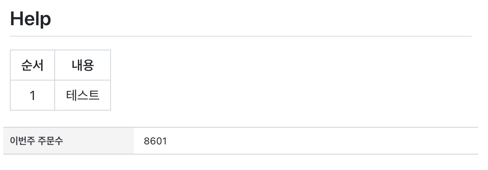
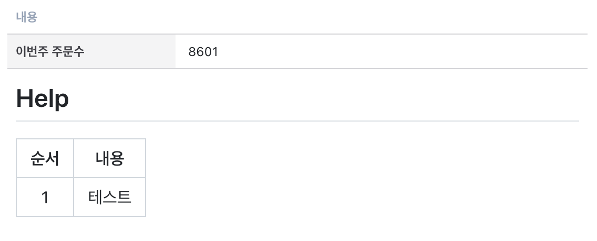

`type: markdown` 블록은 기본적으로 상단에 표시될 수 있습니다. 쿼리 블록 등과 작성 순서대로 배치하고 싶다면 Markdown 블록에 `display: item`을 지정합니다.

```yaml
blocks:
  - type: query
    resource: mysql.qa
    sqlType: select
    sql: |
      SELECT 8601 AS '이번 주 주문 수'

  - type: markdown
    display: item
    content: |
      ## 안내
      여기에 안내 문구를 작성합니다.
```

### 페이지를 여러 영역으로 나누어 배치하려면 어떻게 하나요?

페이지의 `blocks`에서 `top`, `left`, `center`, `right`, `bottom` 타입을 사용해 영역을 구분할 수 있습니다. 각 영역 안에 다시 query, http, markdown 등의 블록을 배치할 수 있습니다.

```yaml
pages:
  - path: dashboard
    blocks:
      - type: top
        title: 대시보드
        blocks:
          - type: markdown
            content: 상단 안내 영역

      - type: left
        blocks:
          - type: query
            resource: mysql.qa
            sqlType: select
            sql: SELECT 1

      - type: right
        blocks:
          - type: markdown
            content: 오른쪽 안내 영역
```

영역별 너비와 여백은 각 영역의 `class`, `style`, `containerStyle` 등 화면 설정을 이용해 조정합니다.

### Markdown 내용을 원하는 위치에 표시하려면 어떻게 하나요?

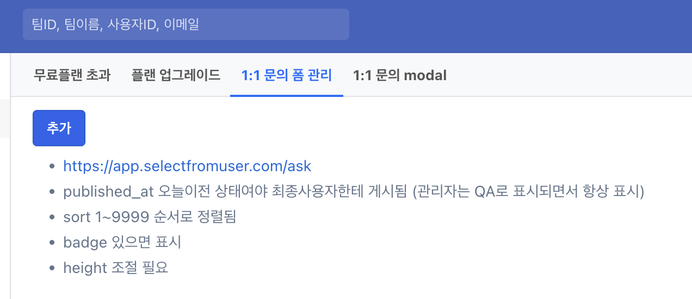

Markdown 블록에 `display: item`을 지정하면 다른 블록과 작성 순서에 맞춰 배치할 수 있습니다. 기본 동작과 차이가 있으므로, 페이지 내 표시 순서를 확인하면서 적용해 주세요.

### 설치형에서 허용해야 하는 도메인은 무엇인가요?

설치형 셀렉트어드민 환경에서 아웃바운드 통신이나 UI 접속 도메인을 제한하고 있다면 다음 도메인을 허용 목록에 추가해야 합니다.

| 용도 | 허용 도메인 |
|---|---|
| 설치형 서버의 아웃바운드 통신 | `https://api.selectfromuser.com` |
| UI 접속 | `https://*.selectfromuser.com` |

네트워크 정책에 따라 도메인 허용 방식이 다를 수 있으므로, 방화벽이나 프록시에서 사용하는 규칙 형식에 맞춰 등록해 주세요. 추가 지원이 필요한 경우 셀렉트프롬유저 고객지원에 문의할 수 있습니다.

### 좌측 메뉴(LNB)를 숨기려면 어떻게 하나요?

좌측 메뉴 영역을 숨기려면 `hideLeftMenu` 설정을 사용하고, 메뉴 구성에는 `type: nav`를 함께 사용합니다.

`hideLeftMenu`는 좌측 메뉴 표시 여부를 조정하고, `menus`의 `type: nav`는 메뉴 영역의 구성을 지정합니다. 두 설정을 함께 적용해 화면의 좌측 메뉴 영역을 조정할 수 있습니다. 실제 메뉴 배치와 표시 결과는 사용 중인 페이지 구성에 맞춰 확인해 주세요.

### 내 IP 주소를 확인하려면 어떻게 하나요?

접속 IP 정책을 설정하거나 팀원의 IP를 확인해야 할 때는 다음 주소에 접속하면 현재 접속한 IP 주소를 확인할 수 있습니다.

`https://api.selectfromuser.com/client-ip`

IP 허용 목록을 설정할 때는 등록하려는 사용자가 실제로 접속하는 네트워크의 IP인지 확인해 주세요.

## 파라미터와 입력값

### 파라미터에 입력된 값의 앞뒤 공백을 제거하려면 어떻게 하나요?

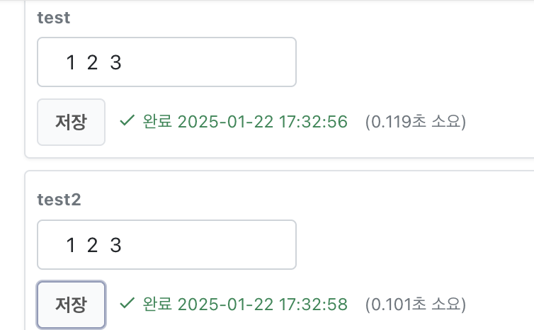
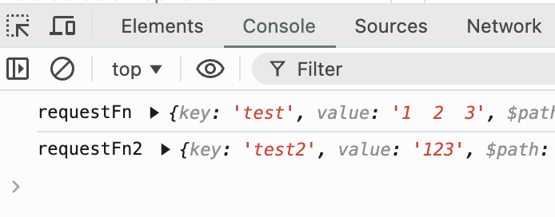

`requestFn`에서 JavaScript의 `trim()`을 사용하면 요청 직전에 문자열의 앞뒤 공백을 제거할 수 있습니다.

```yaml
requestFn: |
  const param = params.find(e => e.key === 'name')

  if (param?.value) {
    param.value = param.value.trim()
  }

  return true
```

문자열 내부의 연속된 공백까지 제거하려면 `replace()`를 함께 사용할 수 있습니다.

```javascript
param.value = param.value.trim().replace(/\s+/g, '')
```

`validateFn`은 입력값 검증에, `requestFn`은 실제 요청 직전의 값 처리에 사용하는 방식으로 구분하면 좋습니다.

### 파라미터 값이 문자열(String)로 전달됩니다. 숫자(Number)로 전달하려면 어떻게 하나요?

셀렉트어드민의 파라미터 값은 기본적으로 문자열로 처리됩니다. 숫자로 사용해야 하는 경우 요청 직전에 `Number()` 또는 단항 `+` 연산자로 변환할 수 있습니다.

```yaml
requestFn: |
  const amount = params.find(e => e.key === 'amount')
  amount.value = Number(amount.value)

  return true
```

HTTP 블록의 요청 데이터에서 직접 변환하려면 다음과 같이 사용할 수도 있습니다.

```yaml
axios:
  method: POST
  url: https://example.com/api
  data:
    amount: "{{ Number(amount.value) }}"
```

실제 API가 숫자 타입을 요구하는지, 문자열 숫자도 허용하는지는 API 명세를 함께 확인해 주세요.

불리언 값도 템플릿 표현식으로 변환할 수 있습니다. 원문 예제에서는 `Boolean(isActive)`, `isActive == true`, `!!isActive`를 사용해 JSON boolean으로 전달하는 방법을 함께 보여줍니다.

```yaml
axios:
  method: POST
  url: https://example.com/api
  data:
    age: "{{ Number(age) }}"
    isActive: "{{ Boolean(isActive) }}"
```

실제 요청 결과에서 숫자·문자열·불리언 타입이 어떻게 전달되는지 확인하려면 API 테스트 엔드포인트를 이용해 응답 JSON을 살펴보세요.

### 입력값이 특정 조건을 만족할 때만 제출할 수 있게 하려면 어떻게 하나요?

입력 필드 단위의 검증은 `validateFn` 또는 `validateFromQuery`를 활용할 수 있습니다. 예를 들어 사업자번호의 길이와 숫자 여부를 검사하려면 다음과 같이 작성할 수 있습니다.

```yaml
params:
  - key: businessNumber
    label: 사업자번호
    required: true
    validateFn: |
      if (param.value.length !== 10) {
        return '사업자번호 10자리를 입력해주세요.'
      }

      if (!isFinite(Number(param.value))) {
        return '숫자만 입력해주세요.'
      }

      return true
```

데이터베이스 조회 등을 통해 중복 여부를 확인하는 검증은 `validateFromQuery`를 활용할 수 있습니다. 검증 결과에 따라 제출 자체를 제어하는 경우에는 `requestSubmitFn`도 검토해 주세요.

### 폼의 입력값이 유효하지 않을 때 제출 버튼을 비활성화하려면 어떻게 하나요?

`submitButton.disabledFn`을 사용하면 조건에 따라 제출 버튼을 비활성화할 수 있습니다.

```yaml
submitButton:
  disabledFn: |
    const name = params.find(e => e.key === 'name')

    if (!name || name.value.length < 3) {
      return '이름을 3자 이상 입력해주세요.'
    }

    return false
```

- `true`: 버튼 비활성화
- 문자열 반환: 버튼 비활성화 및 안내 메시지 표시
- `false`: 버튼 활성화

필드별 `validateFn`으로 검증하는 방식과 폼 전체 조건을 `disabledFn`으로 검사하는 방식은 목적에 맞게 선택해 주세요.

### 날짜 파라미터의 기본값을 오늘이나 다음 주 기준으로 자동 설정하려면 어떻게 하나요?

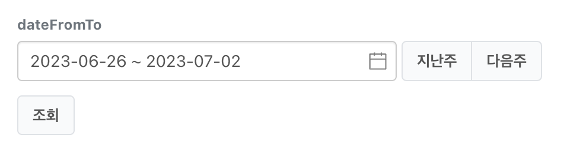

`defaultValueFn`에서 날짜 계산 함수를 사용해 기본값을 지정할 수 있습니다. 커뮤니티 예제에서는 Moment.js를 이용해 다음 주의 시작일과 종료일을 설정했습니다.

```yaml
params:
  - key: dateFromTo
    label: 조회기간
    format: date
    range: true
    defaultValueFn: |
      return [
        moment().add(1, 'week').startOf('week').add(1, 'day').format('YYYY-MM-DD'),
        moment().add(1, 'week').endOf('week').add(1, 'day').format('YYYY-MM-DD')
      ]
```

날짜 범위 파라미터는 시작일과 종료일이 각각 전달되는 방식에 유의해 주세요. 날짜 계산 기준과 타임존도 실제 업무 기준에 맞는지 확인하는 것이 좋습니다.

### 숫자 입력에 천 단위 쉼표나 통화 기호를 표시하려면 어떻게 하나요?

`numberFormat`을 사용하면 숫자 입력값에 천 단위 구분 기호, 소수점 자릿수, 접두사 및 접미사를 지정할 수 있습니다.

```yaml
params:
  - key: price
    numberFormat:
      separator: ','
      precision: 2
      prefix: '₩'
      masked: false
```

예를 들어 `1234.5`를 `₩1,234.50` 형태로 표시할 수 있습니다. `masked: false`인 경우 화면 표시 형식과 실제 전달되는 숫자값을 구분할 수 있습니다.

**주의:** 커뮤니티 안내에 따르면 `numberFormat`은 `format: number`와 함께 적용할 수 없습니다.

### 쉼표로 여러 값을 검색하거나 태그 형태로 여러 항목을 선택하려면 어떻게 하나요?

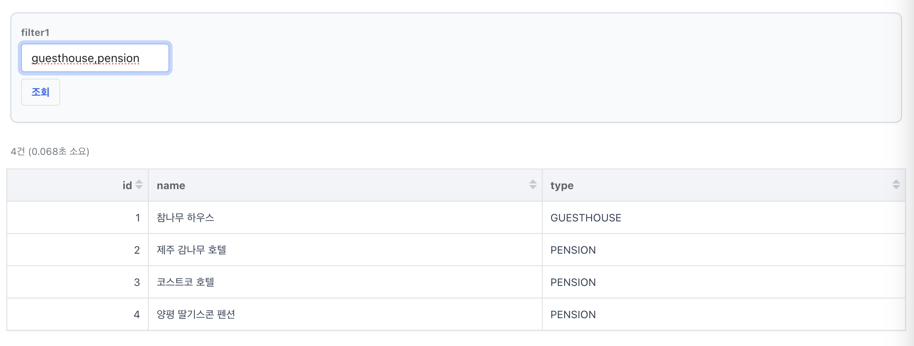
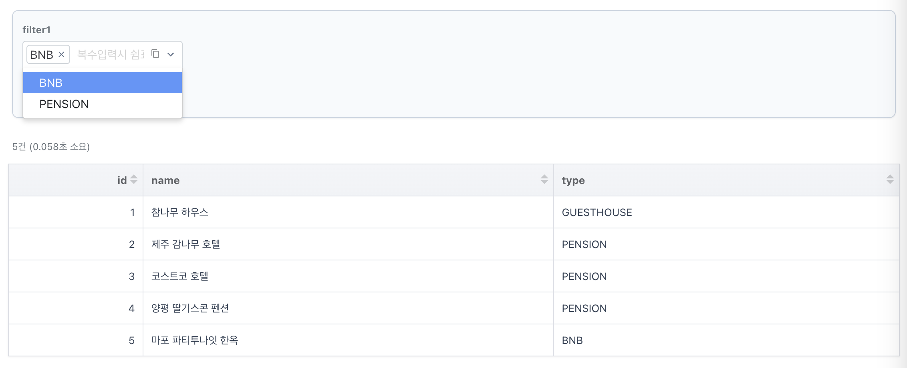

쉼표로 입력한 값을 SQL의 `FIND_IN_SET` 등으로 처리하거나, 파라미터에 `multiple: true`와 `selectOptions.taggable: true`를 설정해 여러 항목을 선택하도록 구성할 수 있습니다.

태그형 선택 예시:

```yaml
params:
  - key: types
    datalist:
      - BNB
      - PENSION
    multiple: true
    selectOptions:
      enabled: true
      taggable: true
```

실제 SQL에서 여러 값을 처리하는 방식은 사용하는 데이터베이스와 파라미터 형식에 따라 달라집니다.

## 데이터 조회와 요청 처리

### API 요청 URL에 입력한 파라미터 값을 넣으려면 어떻게 하나요?

HTTP 블록의 URL에서 파라미터 값을 템플릿 형태로 참조할 수 있습니다. 값의 타입이 숫자여야 한다면 숫자 변환도 함께 적용할 수 있습니다.

```yaml
- type: http
  axios:
    method: GET
    url: "https://example.com/api/users/{{userId}}"
  params:
    - key: userId
```

실제 URL 템플릿 문법과 파라미터 참조 방식은 사용하는 블록 설정에 맞춰 확인해 주세요. 요청 본문(body)에 값을 전달하는 경우에는 `axios.data`를 활용할 수 있습니다.

### HTTP 요청의 body에 파라미터 값을 전달하려면 어떻게 하나요?

HTTP 블록의 `axios.data`에서 파라미터 값을 템플릿으로 사용할 수 있습니다.

```yaml
- type: http
  axios:
    method: POST
    url: https://example.com/api
    data:
      customerId: "{{customerId}}"
      version: "{{API_VERSION}}"
  params:
    - key: customerId
    - key: API_VERSION
      valueFromEnv: true
```

숫자 타입으로 전달해야 하는 값은 `Number()` 또는 `+`를 이용해 변환할 수 있습니다.

### API 응답 JSON의 데이터를 화면에 맞게 가공하려면 어떻게 하나요?

`responseFn`에서 API 응답 데이터를 가공할 수 있습니다. 예를 들어 응답의 중첩 배열에서 합계를 계산하거나 화면에서 사용할 필드를 새로 만들 수 있습니다.

```yaml
responseFn: |
  const result = rows.map(row => ({
    value: row.id,
    label: row.name,
    amountTotal: _.sum(row.amounts.map(item => item.amount))
  }))

  return result
```

응답 데이터의 실제 구조에 따라 `rows`, `data` 등 접근해야 하는 값이 달라질 수 있으므로 API 응답 구조를 먼저 확인해 주세요.

각 행을 개별적으로 가공해야 한다면 `responseRowFn`을 사용할 수 있습니다. 예를 들어 가격을 만 원 단위로 변환하고 원래 필드를 제거하려면 다음과 같이 작성합니다.

```yaml
responseRowFn: |
  row.price_m = row.price * 10000
  delete row.price
```

새로운 객체만 남기고 싶다면 `row`에 새 객체를 할당할 수도 있습니다.

```yaml
responseRowFn: |
  row = {
    price_m: row.price * 10000
  }
```

기존 필드를 유지할지, 삭제할지, 새 객체로 교체할지 의도에 맞게 선택해 주세요.

### API 요청이 성공했을 때나 실패했을 때 메시지를 표시하려면 어떻게 하나요?

요청 결과에 따라 `responseFn` 또는 `responseErrorFn`을 사용할 수 있습니다. 성공한 경우 응답 데이터를 확인해 후속 처리를 할 수 있고, 실패한 경우 오류 메시지를 가공해 사용자에게 안내할 수 있습니다.

```yaml
responseFn: |
  console.log('요청 성공:', data)
```

```yaml
responseErrorFn: |
  console.log('요청 실패:', error)
```

오류 객체의 실제 필드와 반환 구조는 사용하는 요청 블록 및 API 응답에 따라 다를 수 있습니다. 민감한 인증정보나 개인정보가 로그·화면에 노출되지 않도록 주의해 주세요.

### 하나의 버튼이나 요청에서 다른 블록의 쿼리/API를 실행하려면 어떻게 하나요?

블록에 `id`를 지정하면 JavaScript 함수에서 해당 블록을 참조할 수 있습니다. `trigger()`를 호출해 다른 블록을 실행하는 방식으로 여러 요청을 연결할 수 있습니다.

```yaml
- type: query
  id: query1
  resource: mysql.qa
  sqlType: insert
  sql: |
    INSERT INTO wine_stock (name)
    VALUES (:name)
  params:
    - key: name
  requestSubmitFn: |
    await query2.trigger()
    return true

- type: query
  id: query2
  resource: redis-cloud
  sqlType: update
  commands:
    - SET wine {{name}}
```

두 번째 요청에서 첫 번째 블록의 파라미터나 결과를 사용해야 한다면 `requestFn`에서 값을 전달하도록 구성할 수 있습니다. 실행 순서와 오류 처리도 함께 설계해 주세요.

### API 요청 결과를 다음 API 요청의 인증 헤더에 넣으려면 어떻게 하나요?

커뮤니티 예제에서는 첫 번째 HTTP 요청의 응답에서 토큰을 받아 저장한 뒤, 다음 HTTP 요청의 `Authorization` 헤더에 전달하는 방식을 소개합니다.

다만 토큰은 민감한 인증정보입니다. 브라우저 저장소에 보관하는 방식은 보안 위험이 있을 수 있으므로, 실제 서비스에서는 토큰의 민감도·만료시간·접근 권한을 고려하고 가능한 경우 서버 측에서 안전하게 처리하는 방식을 권장합니다.

### API나 SQL 조회 결과가 많을 때 서버 사이드 페이지네이션을 적용하려면 어떻게 하나요?

`paginationOptions`와 `mode: remote`를 활용하면 서버에서 페이지 단위로 데이터를 조회하도록 구성할 수 있습니다.

```yaml
- type: http
  axios:
    method: GET
    url: https://example.com/api/items
    qs:
      offset: "{{page_offset}}"
      limit: "{{page_limit}}"
  mode: remote
  paginationOptions:
    enabled: true
    perPage: 20
```

API 응답에 전체 데이터 개수가 포함되어 있다면 `responseFn`에서 `data.total`에 전체 건수를 설정하는 방법도 커뮤니티에 소개되어 있습니다. 실제 응답 구조에 맞게 수정해 주세요.

### 조회 결과에 합계 행을 추가하려면 어떻게 하나요?

`responseFn`에서 조회 결과를 순회해 합계를 계산하고, 합계 행을 `rows`에 추가할 수 있습니다.

```yaml
responseFn: |
  let total = 0

  for (const row of rows) {
    total += Number(row.amount) || 0
  }

  rows.push({
    name: '합계',
    amount: total
  })
```

합계 행을 추가하면 정렬·페이지네이션·내보내기 결과에도 영향을 줄 수 있으므로 실제 화면 동작을 확인해 주세요.

### Markdown 블록에서 호출한 행의 데이터를 사용하려면 어떻게 하나요?

테이블이나 폼의 컬럼에서 `openModal`로 모달을 열고, 모달 안에 Markdown 블록을 배치한 경우 `template` 기능을 통해 호출한 행의 필드를 Markdown 내용에 표시할 수 있습니다.

예를 들어 `name`과 `vintage` 컬럼을 모달의 Markdown 내용에서 사용하려면 다음과 같이 구성할 수 있습니다.

```yaml
blocks:
  - type: query
    resource: mysql.qa
    sqlType: select
    sql: >
      SELECT * FROM wine_stock LIMIT 10
    display: form
    columns:
      name:
        openModal: view
      vintage:
    modals:
      - path: view
        blocks:
          - type: markdown
            content: |
              ## Product: {{name}}

              vintage: {{vintage}}
```

위 예제에서는 호출한 행의 `name`, `vintage` 값을 `{{name}}`, `{{vintage}}` 형태로 참조합니다. 실제 필드명은 조회 결과에 포함된 컬럼명과 일치해야 합니다.

## 테이블과 데이터 조작

### 테이블에서 특정 행을 삭제하려면 어떻게 하나요?

커뮤니티 예제에서는 두 가지 방식을 소개합니다.

**1. 각 행에 삭제 버튼 표시**

```yaml
columns:
  id:
  작업:
    append: true
    buttons:
      - label: 삭제
        type: danger-light
        openAction: deleteRow

actions:
  - name: deleteRow
    hidden: true
    single: true
    type: query
    resource: mysql.dev
    sqlType: delete
    sql: DELETE FROM your_table WHERE id = :id
    params:
      - key: id
        valueFromRow: id
```

**2. 체크박스로 여러 행을 선택해 삭제**

```yaml
selectOptions:
  enabled: true

actions:
  - label: 삭제
    forEach: true
    type: query
    resource: mysql.dev
    sqlType: delete
    sql: DELETE FROM your_table WHERE id = :id
    params:
      - key: id
        valueFromSelectedRows: id
```

삭제 작업은 되돌리기 어려울 수 있으므로, 실제 적용 전 대상 행과 권한을 충분히 확인해 주세요.

### 테이블에서 선택한 행의 데이터를 모달로 전달하려면 어떻게 하나요?

`selectOptions`로 행 선택 기능을 활성화한 뒤, 모달 내부의 `requestFn`에서 `useTableSelectedRows()`를 사용해 선택된 행의 데이터를 가져올 수 있습니다.

```yaml
selectOptions:
  enabled: true
actions:
  - label: 선택 항목 확인
    openModal: selected
modals:
  - path: selected
    blocks:
      - type: query
        resource: mysql.qa
        sqlType: select
        sql: SELECT JSON_ARRAY(:ids) AS ids
        params:
          - key: ids
            hidden: true
        requestFn: |
          const selectedRows = useTableSelectedRows()
          const ids = params.find(e => e.key === 'ids')
          ids.value = selectedRows.map(row => row.id)
```

선택된 행에서 어떤 필드를 전달할지와 모달에서 사용하는 파라미터 이름을 일치시켜 주세요.

### 모달에서 부모 테이블의 선택된 행 데이터를 가져오려면 어떻게 하나요?

`useModalRow()`를 사용하면 모달을 연 부모 테이블의 행 데이터를 가져올 수 있습니다. 커뮤니티 예제에서는 `requestFn` 또는 `responseFn`에서 사용할 수 있다고 안내합니다.

```yaml
responseFn: |
  const modalRow = useModalRow()
  console.log(modalRow)
```

모달을 여는 방식과 전달되는 행 데이터 구조에 따라 활용 가능한 값이 달라질 수 있으므로, 실제 데이터 구조를 확인해 주세요.

### 선택한 행의 값에 따라 테이블 버튼을 다르게 표시하려면 어떻게 하나요?

`columns`의 `buttons.visible`에서 `row` 데이터를 조건으로 사용할 수 있습니다.

```yaml
columns:
  작업:
    append: true
    buttons:
      - label: 내역 입력
        openAction: memo
        visible: "{{ !row.name }}"
      - label: 삭제
        openAction: delete
        visible: "{{ !!row.name }}"
```

예제에서는 `name` 값이 없는 행에는 입력 버튼을, 값이 있는 행에는 삭제 버튼을 표시합니다. 실제 업무 상태값에 맞춰 조건을 변경해 주세요.

### JSON 데이터를 테이블 형태로 수정하려면 어떻게 하나요?

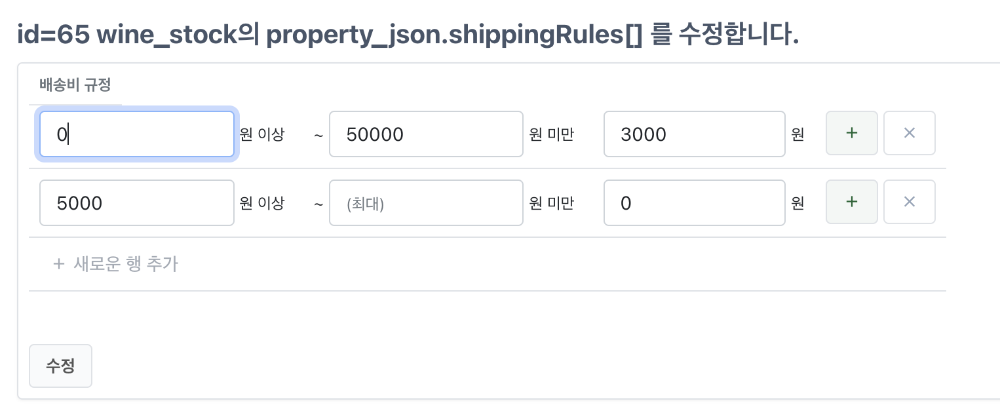
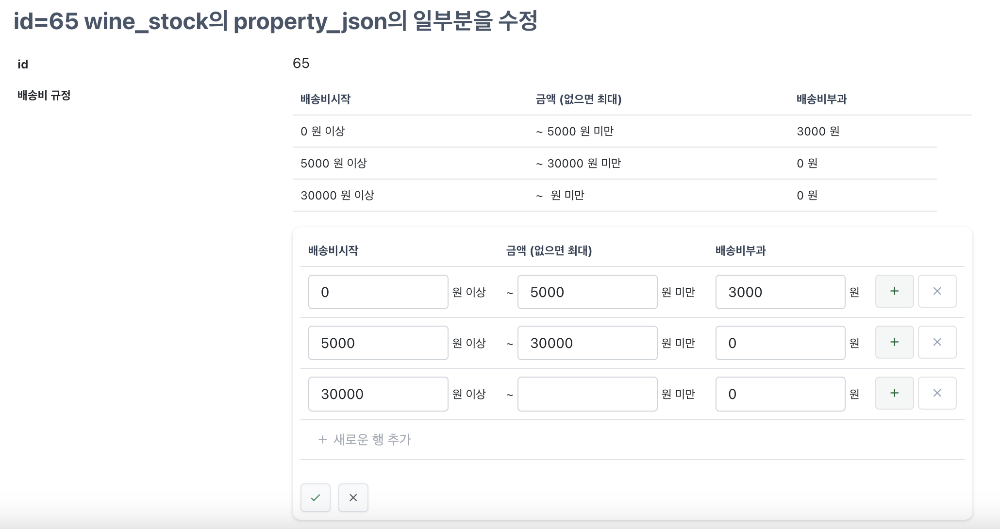

`format: table`을 사용하면 JSON 배열 형태의 데이터를 표 형태로 입력·수정하는 UI를 구성할 수 있습니다. `headers`에서 각 열의 라벨, 입력 형식, 필수 여부 등을 설정하고, `requestFn`에서 저장할 JSON 구조로 변환할 수 있습니다.

```yaml
params:
  - key: rules
    format: table
    headers:
      minAmount:
        label: 최소 금액
        format: number
        required: true
      maxAmount:
        label: 최대 금액
        format: number
      shippingCost:
        label: 배송비
        format: number
```

데이터베이스에 JSON 문자열로 저장해야 하는 경우에는 `requestFn`에서 `JSON.stringify()`를 활용하는 방식도 검토할 수 있습니다.

### 테이블에 별도의 버튼 영역을 추가하려면 어떻게 하나요?

테이블의 각 데이터 칸 안이 아니라 별도의 버튼 영역을 왼쪽에 표시하려면 컬럼에 `prepend: true`와 `buttons`를 함께 사용할 수 있습니다.

```yaml
columns:
  "  ":
    width: 200px
    prepend: true
    buttons:
      - label: 화면열기
        openUrl: https://app.example.com/items/{{id}}
        class: w-50
      - label: 수정
        type: primary-light
        class: w-50
        openModal: edit
```

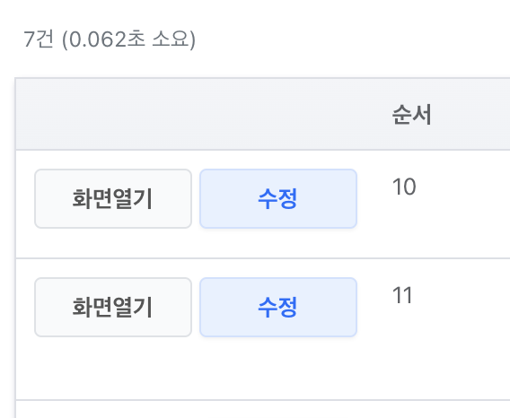

`openUrl`에는 실제 이동할 주소를, `openModal`에는 열려는 모달 경로를 지정합니다. 예제의 URL과 모달 경로는 사용하는 프로젝트에 맞게 바꿔 주세요.

## 차트와 화면 구성

### 파이 차트나 도넛 차트에 퍼센트 비율을 표시하려면 어떻게 하나요?

차트의 옵션에서 데이터 라벨 또는 툴팁 표시 방식을 설정할 수 있습니다. 구체적인 설정은 사용 중인 차트 유형과 라이브러리에 따라 달라집니다. 셀렉트어드민 커뮤니티에서는 파이·도넛 차트의 비율 표시 예제를 공유하고 있습니다.

### 누적 막대 차트(stacked bar)를 만들려면 어떻게 하나요?

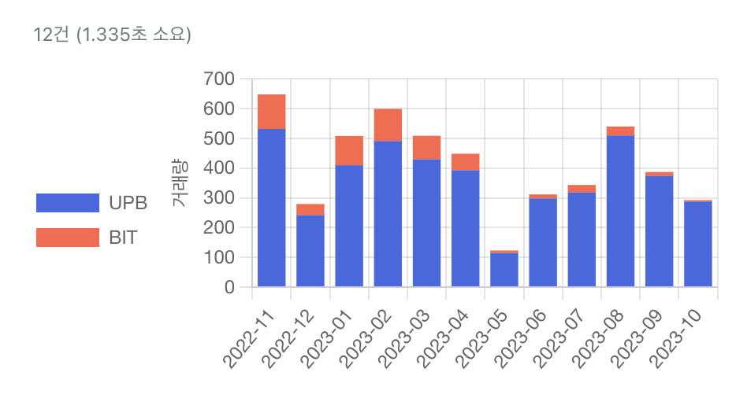

`chartOptions.options.scales`에서 x축과 y축의 `stacked: true`를 설정하면 여러 데이터 시리즈를 누적해서 표시할 수 있습니다.

```yaml
chartOptions:
  type: bar
  x: date
  y:
    - UPB
    - BIT
  options:
    scales:
      x:
        stacked: true
      y:
        stacked: true
        title:
          display: true
          text: 거래량
    plugins:
      legend:
        position: left
```

### 차트에 좌우 두 개의 Y축을 표시하려면 어떻게 하나요?

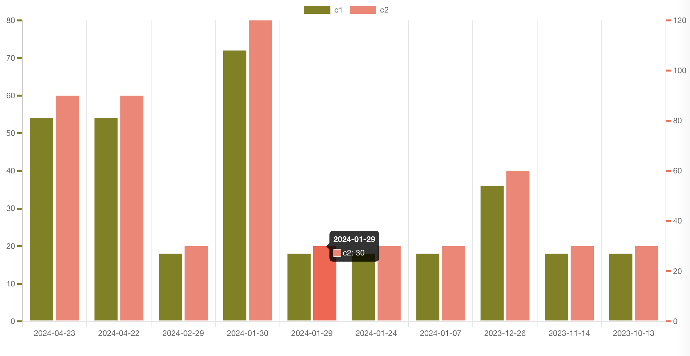

Chart.js 기반 `chartOptions`에서 각 데이터셋에 `yAxisID`를 지정하고, `options.scales`에 각 축의 위치를 설정할 수 있습니다.

```yaml
chartOptions:
  type: bar
  x: date
  y:
    - count
    - amount
  data:
    datasets:
      - yAxisID: A
      - yAxisID: B
  options:
    scales:
      A:
        type: linear
        position: left
      B:
        type: linear
        position: right
```

데이터셋과 축의 ID가 서로 일치해야 합니다.

### 지표 카드(metric)의 열 개수나 간격을 조절하려면 어떻게 하나요?

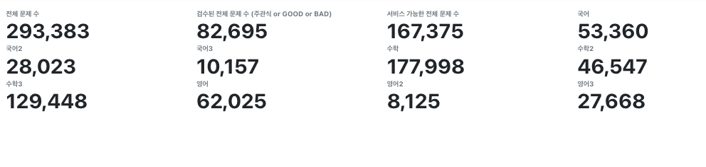
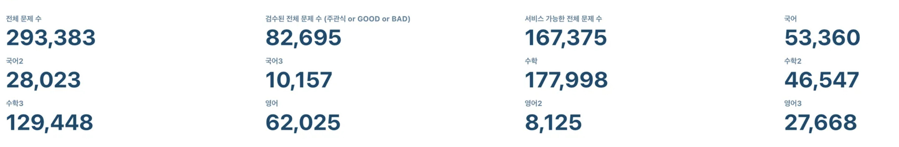

`display: metric`을 사용하는 블록에서 `metricOptions.containerClass`를 지정할 수 있습니다. Tailwind CSS 클래스를 활용해 열 개수와 간격을 조정하는 예제가 커뮤니티에 공유되어 있습니다.

```yaml
display: metric
metricOptions:
  containerClass: grid grid-cols-4 gap-3
  labelClass: text-sky-900/70 text-xs font-bold
  valueClass: text-sky-900 text-4xl font-bold
```

### SQL 조회 결과에 순번이나 순위를 표시하려면 어떻게 하나요?

데이터베이스에서 지원하는 윈도 함수 `ROW_NUMBER()` 또는 `RANK()`를 사용할 수 있습니다.

```sql
SELECT
  *,
  ROW_NUMBER() OVER (ORDER BY number DESC) AS rank
FROM test
ORDER BY number DESC
LIMIT 10;
```

- `ROW_NUMBER()`: 값이 같더라도 각 행에 서로 다른 순번을 부여합니다.
- `RANK()`: 정렬 기준 값이 같으면 같은 순위를 부여하고 다음 순위는 건너뜁니다.

## 파일·지도·외부 연동

### 엑셀이나 CSV 파일을 파라미터로 업로드해 데이터를 처리하려면 어떻게 하나요?

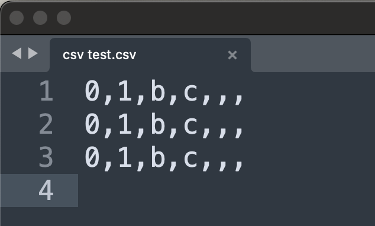

파일을 파라미터로 받으려면 `format: sheet`를 사용할 수 있습니다. 파일 형식과 미리보기, 읽을 범위 등을 설정할 수 있습니다.

```yaml
params:
  - key: sheet
    format: sheet
    accept: .xlsx
    range: 1
    preview: true
```

커뮤니티에서는 Apple Numbers에서 CSV로 내보낼 때 따옴표가 생략되어 데이터 처리에 문제가 생길 수 있다는 사례를 공유했습니다. 한글 데이터 등에서 문제가 발생한다면 `.xlsx` 형식으로 내보내 업로드하는 방법을 고려해 주세요.

### 여러 파일을 한 번에 다운로드하려면 어떻게 하나요?

선택된 행을 기준으로 여러 요청을 실행하거나 `downloadAfterSubmit` 등을 활용할 수 있습니다. 파일마다 별도 다운로드가 필요한 경우에는 선택된 데이터 목록을 순회하는 방식으로 구현할 수 있습니다.

구체적인 구현은 다운로드할 데이터의 위치, 파일 생성 API, 파일 형식에 따라 달라집니다.

### API 응답으로 받은 파일이나 이미지를 표시하거나 다운로드하려면 어떻게 하나요?

HTTP 블록에서 `responseType: blob`을 지정하면 서버가 반환하는 파일 데이터를 처리할 수 있습니다. 파일 다운로드에는 `filename`을 지정할 수 있으며, 이미지 표시에는 `display: image` 등을 활용할 수 있습니다.

```yaml
- type: http
  axios:
    url: https://example.com/export
    method: POST
  responseType: blob
  filename: export.xlsx
```

서버가 파일명을 직접 전달하는 경우에는 `Content-Disposition` 응답 헤더도 확인해 주세요.

### 네이버 지도에 데이터베이스의 위치 데이터를 표시하려면 어떻게 하나요?

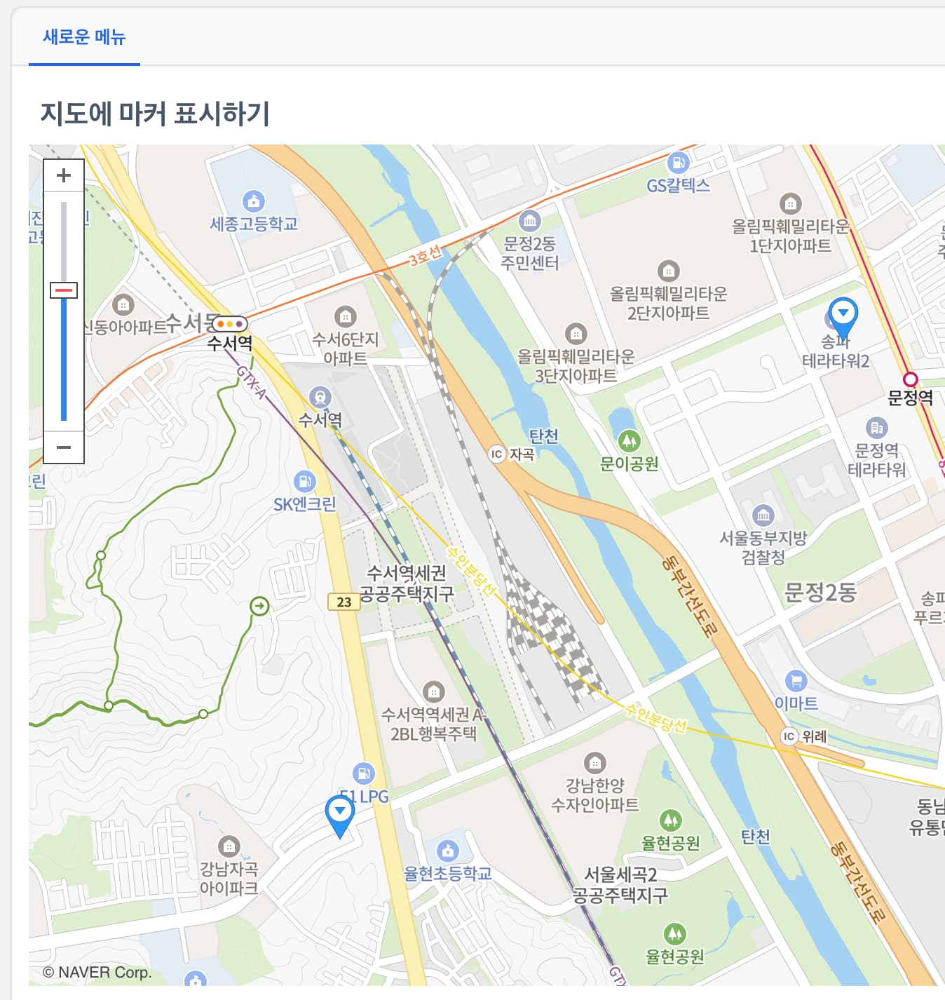
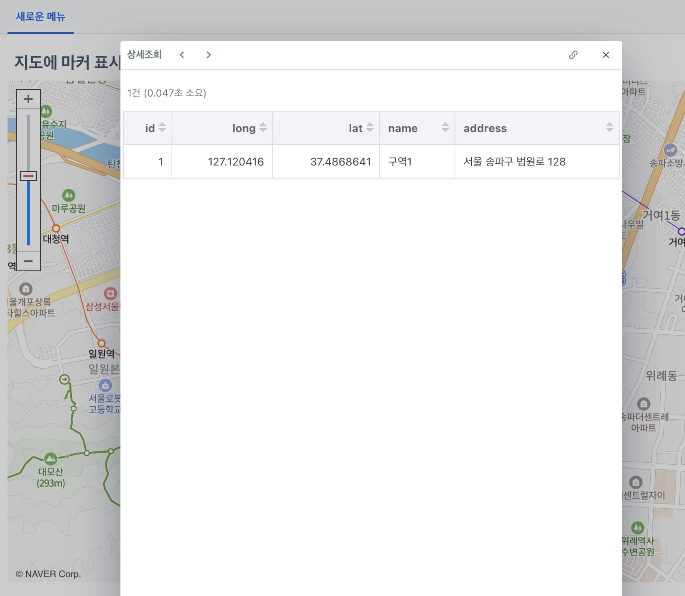

위도·경도 데이터가 있다면 `display: map`을 사용해 지도에 마커를 표시할 수 있습니다. `displayFn`에서 지도 API를 활용해 마커를 추가하거나 클릭 이벤트에 모달을 연결하는 예제가 공유되어 있습니다.

```yaml
- type: query
  resource: mysql.qa
  sqlType: select
  sql: SELECT * FROM locations
  display: map
  displayFn: |
    for (const row of rows) {
      new naver.maps.Marker({
        position: new naver.maps.LatLng(row.lat, row.long),
        title: row.name,
        map: map
      })
    }
  height: 600px
  width: 100%
```

네이버 지도 API 키와 도메인 인증 설정은 네이버 클라우드 플랫폼의 현재 정책에 맞춰 별도로 준비해야 합니다.


### 데이터베이스에 SSH 터널링으로 연결할 수 있나요?

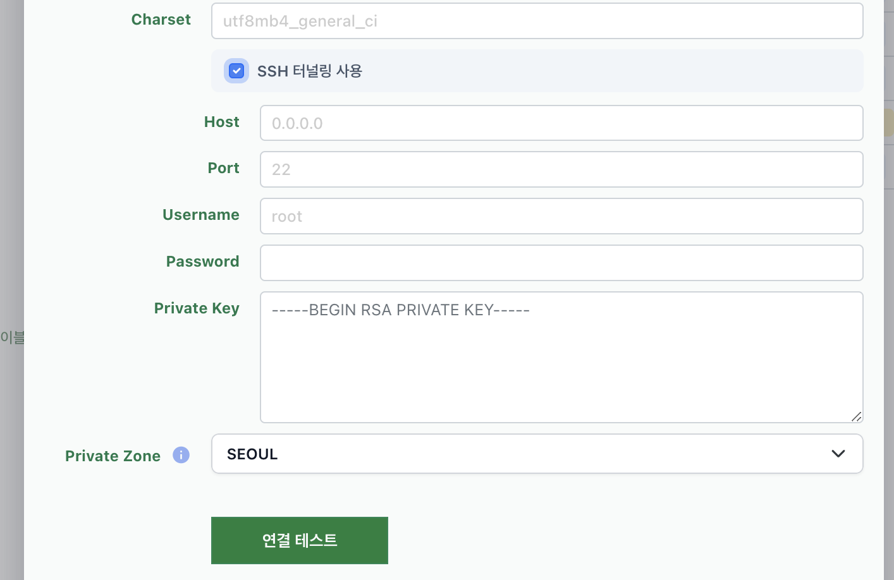
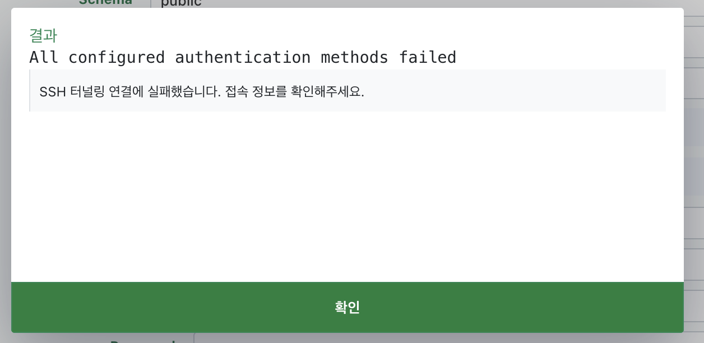

커뮤니티 공지 기준으로 SSH 터널링은 MySQL, PostgreSQL, MSSQL 리소스에서 지원된다고 안내되어 있습니다. 연결 정보 입력 후 연결 테스트와 저장을 진행하는 방식입니다.

SSH 접속 정보가 변경된 경우 기존 설정을 삭제한 뒤 다시 추가하는 방법이 안내되어 있습니다. 방화벽에서는 SSH 접속에 필요한 서버 및 bastion host의 허용 IP 대역도 확인해야 합니다.

지원 범위와 설정 방법은 실제 사용 중인 배포 버전과 네트워크 구성에 따라 달라질 수 있습니다.

### 네이버 지도에 DB의 폴리곤 데이터를 표시하려면 어떻게 하나요?

행정구역이나 서비스 구역처럼 여러 좌표로 이루어진 영역을 지도에 표시하려면, 폴리곤 좌표를 데이터베이스에 JSON으로 저장하고 셀렉트어드민의 `displayFn`에서 네이버 지도 API가 사용하는 좌표 객체로 변환할 수 있습니다.

**1. 폴리곤 테이블 구성 예시**

```sql
CREATE TABLE Polygons (
    id INT PRIMARY KEY AUTO_INCREMENT,
    name VARCHAR(255) NOT NULL,
    color VARCHAR(7) DEFAULT '#ff0000',
    coordinates JSON NOT NULL,
    created_at TIMESTAMP DEFAULT CURRENT_TIMESTAMP
);
```

`coordinates`에는 위도·경도 좌표 배열을 JSON으로 저장합니다. 예를 들어 다음과 같은 형태입니다.

```json
[[37.37544345085402, 127.11224555969238], [37.37230584065902, 127.10791110992432], [37.35975408751081, 127.10795402526855]]
```

**2. 좌표 데이터 조회**

```sql
SELECT id, name, color, coordinates
FROM Polygons;
```

**3. 셀렉트어드민에서 폴리곤 그리기**

아래 예제는 조회 결과가 `rows`로 전달된다고 가정합니다. 네이버 지도 JavaScript API가 로드되어 있고, 지도 객체 `map`이 준비되어 있어야 합니다.

```yaml
- type: query
  resource: mysql.qa
  sqlType: select
  sql: SELECT id, name, color, coordinates FROM Polygons
  display: map
  displayFn: |
    rows.forEach(function(row) {
      var coordinates = JSON.parse(row.coordinates);

      var path = coordinates.map(function(coord) {
        return new naver.maps.LatLng(coord[0], coord[1]);
      });

      new naver.maps.Polygon({
        map: map,
        paths: [path],
        fillColor: row.color || '#ff0000',
        fillOpacity: 0.3,
        strokeColor: row.color || '#ff0000',
        strokeOpacity: 0.6,
        strokeWeight: 3
      });
    });
```

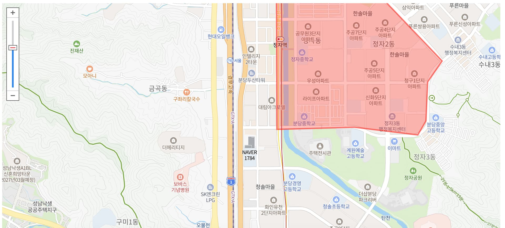

이 예제는 폴리곤 저장 및 표시 방법을 설명하기 위한 구현 예시입니다. 데이터베이스의 JSON 지원 여부, 실제 좌표 형식, 네이버 지도 API 로드 및 인증 설정은 사용하는 환경에 맞게 확인해 주세요.

## 고급 활용과 추가 설정

### JavaScript에서 여러 값 중 하나와 일치하는지 확인하려면 어떻게 하나요?

특정 컬럼 값이 여러 후보 중 하나인지 확인할 때는 `||`를 연결하거나 배열의 `includes()`를 사용할 수 있습니다.

```javascript
if (row.status === 'a' || row.status === 'b' || row.status === 'c') {
  // 조건에 해당하는 경우
}
```

같은 조건을 배열로 표현하면 다음과 같습니다.

```javascript
if (['a', 'b', 'c'].includes(row.status)) {
  // 조건에 해당하는 경우
}
```

후보 값이 늘어날 수 있다면 `includes()` 방식이 조건을 관리하기 편리합니다.

### HTTP 블록에서 행을 클릭해 상세 모달과 액션을 표시하려면 어떻게 하나요?

HTTP 블록으로 목록을 조회하고, 각 행에서 상세 모달을 열어 추가 API를 호출하거나 액션을 실행할 수 있습니다. 원문 예제는 `viewModal` 안에서 다시 HTTP 요청을 실행하고, 선택된 행의 `id`를 `valueFromRow`로 전달합니다.

```yaml
- type: http
  axios:
    method: GET
    url: https://example.com/api/items
  params:
    - key: id
  viewModal:
    useColumn: id
    blocks:
      - type: http
        axios:
          method: GET
          url: https://example.com/api/items/{{id}}
        params:
          - key: id
            valueFromRow: id
        selectOptions:
          enabled: true
        actions:
          - label: 선택 항목 처리
            type: http
            axios:
              method: POST
              url: https://example.com/api/items/action
```

실제 API 주소와 요청 방식은 사용하는 서비스에 맞게 바꿔야 합니다. 복잡한 탭이나 여러 행 필드를 모달에 전달해야 하는 경우에는 아래의 `modals` 예제처럼 구성하는 방법을 검토해 주세요.

### 캘린더에 표시할 날짜 형식을 YYYY-MM-DD로 맞추려면 어떻게 하나요?

`display: calendar`에서 사용하는 `date` 값이 날짜·시간을 포함하고 있다면, 캘린더에 맞는 날짜 형식으로 변환해야 할 수 있습니다. 원문에서는 `sqlWith`에서 변환하거나 `responseFn`에서 변환하는 두 가지 방법을 소개합니다.

`responseFn`에서 변환하는 예시는 다음과 같습니다.

```yaml
sqlWith:
  - name: source
    resource: mysql.qa
    query: >
      SELECT deleted_at, name
      FROM wine_stock
      WHERE deleted_at IS NOT NULL
sql: >
  SELECT deleted_at AS date, name
  FROM source
params:
  - key: calendar
    range: true
    valueFromCalendar: true
display: calendar
autoload: true
responseFn: |
  rows = rows.map(row => {
    row.date = moment(row.date).format('YYYY-MM-DD')
    return row
  })
  return rows
```

데이터베이스와 날짜 필드에 따라 변환 방식이 달라질 수 있으므로, 실제 조회 결과의 시간대와 날짜값을 확인해 주세요.

### 연동된 파라미터에 따라 다음 선택 목록을 다시 조회하려면 어떻게 하나요?

`datalistFromQuery`에서 다른 파라미터 값을 참조해 단계별 선택 목록을 만들 수 있습니다. 예를 들어 대분류를 선택하면 중분류를 조회하고, 중분류를 선택하면 소분류를 조회하는 방식입니다.

이처럼 이전 파라미터 값에 따라 목록이 달라지는 경우, 하위 `datalistFromQuery`에 `cache: false`를 설정해 이전 조회 결과가 재사용되지 않도록 할 수 있습니다.

```yaml
params:
  - key: level1
    datalistDropdown: true
    datalistFromQuery:
      type: query
      resource: mysql.qa
      sql: |
        SELECT DISTINCT level1 AS value
        FROM categories

  - key: level2
    datalistDropdown: true
    hiddenIfNotOption: true
    datalistFromQuery:
      type: query
      resource: mysql.qa
      sql: |
        SELECT DISTINCT level2 AS value
        FROM categories
        WHERE level1 = :level1
      cache: false

  - key: level3
    datalistDropdown: true
    hiddenIfNotOption: true
    datalistFromQuery:
      type: query
      resource: mysql.qa
      sql: |
        SELECT DISTINCT level3 AS value
        FROM categories
        WHERE level1 = :level1
          AND level2 = :level2
      cache: false
```

목록이 없을 때 입력 항목을 숨기려면 `hiddenIfNotOption`, 비활성화하려면 `disableIfNotOption`을 검토할 수 있습니다.

### 데이터 블록이 로딩되는 동안 스켈레톤을 표시하려면 어떻게 하나요?

블록의 `loading` 설정을 사용하면 데이터 요청이 진행되는 동안 로딩 UI를 표시할 수 있습니다. `loading: true`를 사용하거나 `circle`, `line` 등의 형태를 지정할 수 있습니다.

```yaml
- type: http
  axios:
    url: https://example.com/api/items
    method: GET
  style:
    height: 200px
  loading: true
```

스켈레톤의 모양을 직접 지정하려면 다음과 같이 작성할 수 있습니다.

```yaml
loading:
  - type: circle
  - type: line
  - type: line
```

로딩 중 화면이 흔들리는 현상을 줄이려면 블록의 높이를 미리 지정하는 방법도 소개되어 있습니다. `loading`의 너비를 백분율로 지정하는 동작은 원문에서 확인되지 않았으므로, 필요한 경우 실제 화면에서 테스트해 주세요. 이 사례는 블록의 지연 로딩(lazy loading)을 지원한다는 의미는 아닙니다.

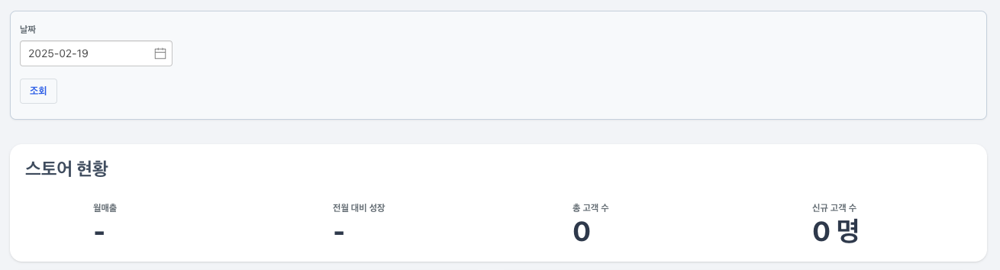

### requestFn이나 responseFn에서 환경변수를 사용하려면 어떻게 하나요?

`useEnv()`를 사용하면 안전하게 export된 환경변수를 `requestFn` 또는 `responseFn`에서 읽을 수 있습니다. 원문에서는 `PUBLIC_`으로 시작하는 환경변수와 `MODE` 값을 예시로 안내합니다.

```yaml
requestFn: |
  const env = useEnv()
  console.log('current environment:', env)
```

개별 값을 사용할 때는 다음과 같이 접근합니다.

```javascript
const env = useEnv()
const publicEnv = env.PUBLIC_ENV
const mode = env.MODE
```

원문에서 안내한 범위는 `PUBLIC_` 접두사가 붙은 export 환경변수입니다. 비밀 키나 서버 전용 인증정보를 브라우저 코드에서 사용할 수 있는 공개 환경변수로 설정하지 않도록 주의해 주세요.

### 조회 결과의 각 행에 기본 체크 상태를 지정하려면 어떻게 하나요?

`selectOptions`를 사용하는 테이블에서 특정 조건에 해당하는 행을 미리 선택 상태로 표시하려면 `responseFn`에서 각 행에 선택 필드를 설정할 수 있습니다.

원문 예제에서는 `vintage`가 2023 이상인 행에 `vgtSelected: true`를 설정합니다.

```yaml
responseFn: |
  return rows.map(row => {
    if (+row.vintage >= 2023) {
      row.vgtSelected = true
    }
    return row
  })
selectOptions:
  enabled: true
```

실제 조건과 선택 필드명은 사용하는 테이블 및 선택 기능 설정에 맞게 확인해 주세요.

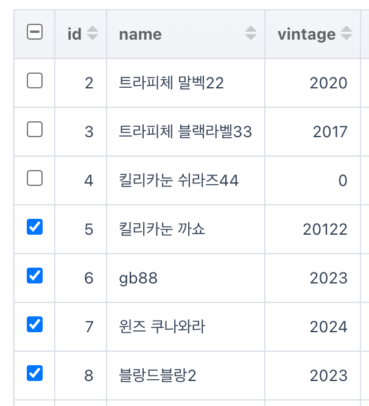

### 여러 YAML 파일에서 공통 파라미터를 재사용하려면 어떻게 하나요?

반복해서 사용하는 `params` 설정은 `global.yml` 파일에 정의한 뒤 다른 파일에서 YAML 앵커와 별칭으로 재사용할 수 있습니다.

`global.yml`에 공통 파라미터를 정의합니다.

```yaml
params_account_id: &params_account_id
  key: account_id
  label: 계정
  multiple: true
  datalist: true
  datalistLength: 20
  datalistPreview: true
  datalistDropdown: true
```

다른 YAML 파일의 `params`에서 별칭을 사용합니다.

```yaml
params:
  - *params_account_id
  - key: name
```

공통 설정을 한 곳에서 수정할 수 있어 편리하지만, 변경 사항이 여러 페이지에 영향을 줄 수 있으므로 적용 후 관련 화면을 함께 테스트해 주세요.

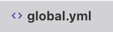

### 선택한 여러 행을 한 번의 HTTP 요청으로 처리하려면 어떻게 하나요?

`selectOptions`와 `actions`를 사용하면 선택된 행을 하나씩 처리하는 대신, 선택된 행들의 값을 하나의 배열로 만들어 한 번의 HTTP 요청으로 전달할 수 있습니다.

```yaml
selectOptions:
  enabled: true
actions:
  - label: 선택 항목 일괄 처리
    type: http
    axios:
      method: POST
      url: https://example.com/api/items/bulk
      body: "{{body.value}}"
    params:
      - key: id
        valueFromSelectedRows: true
      - key: name
        valueFromSelectedRows: true
      - key: body
        hidden: true
    requestFn: |
      const id = params.find(e => e.key === 'id')
      const name = params.find(e => e.key === 'name')
      const body = params.find(e => e.key === 'body')

      body.value = id.value.map((value, index) => ({
        id: value,
        name: name.value[index]
      }))
```

API가 배열 형태의 요청 본문을 지원해야 합니다. 실제 API가 기대하는 필드명과 데이터 구조에 맞게 수정해 주세요.

### Apple Numbers에서 내보낸 CSV를 업로드할 때 주의할 점은 무엇인가요?

커뮤니티 사례에서는 Apple Numbers에서 CSV로 내보낼 때 텍스트를 감싸는 따옴표(quote)가 포함되지 않아 `sheetOptions`로 데이터를 읽는 과정에서 오류가 발생할 수 있다고 안내합니다.

한글 데이터 등을 업로드할 때는 원문에서 권장한 것처럼 Excel에서 `.xlsx` 형식으로 저장한 뒤 업로드하는 방법을 검토해 주세요.

```yaml
params:
  - key: sheet
    format: sheet
    accept: .xlsx
    range: 1
    preview: true
```

`range`는 읽기 시작할 행을 지정하는 옵션이며, `preview: true`를 사용하면 실행 전에 읽힌 데이터를 미리 확인할 수 있습니다.


### 여러 항목을 목록 형태로 선택하고 관리하려면 어떻게 하나요?

`format: listbox`를 사용하면 여러 항목을 한 화면에서 확인하고 선택할 수 있습니다. `multiple: true`로 다중 선택을 활성화하고, `datalistFromQuery`로 옵션을 조회할 수 있습니다.

```yaml
params:
  - key: display_json
    format: listbox
    multiple: true
    listStyle:
      minWidth: 300px
      height: 300px
      overflow: scroll
    datalistFromQuery:
      type: query
      resource: mysql.qa
      sql: |
        SELECT DISTINCT
          name AS value,
          name AS label,
          price
        FROM wine_stock
    template: |
      {{value}}
      <span class="text-xs">{{price}}원</span>
```

기본 옵션을 숨기고 검색 모달에서 항목을 추가하려면 `showOptions: false`와 `buttons.openModal`을 함께 사용할 수 있습니다. 선택 항목을 제거하는 버튼에는 `deleteItem: true`를 사용할 수 있습니다.

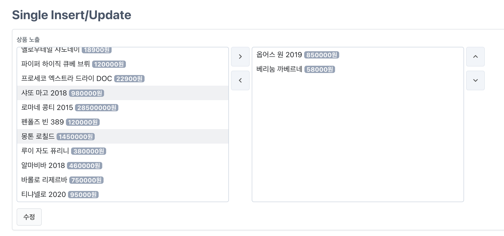
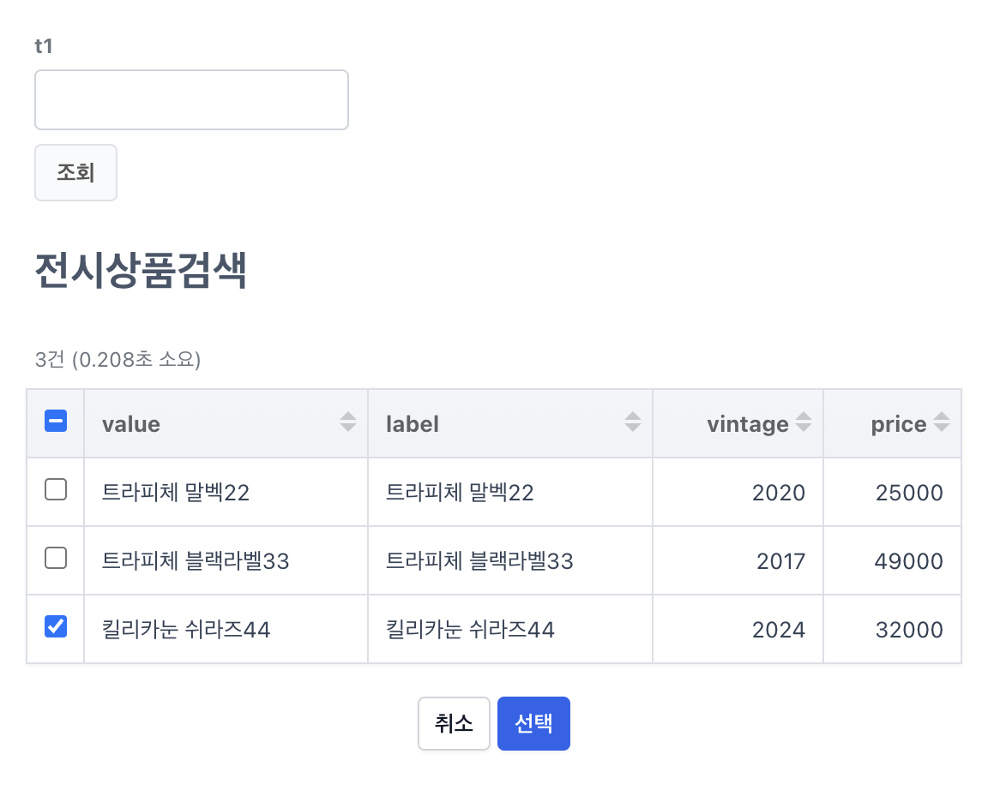

### 블록 단위로 수정 권한을 제한하려면 어떻게 하나요?

블록의 `roles.edit`를 지정하면 해당 블록의 요청에 수정 권한을 적용할 수 있습니다. 원문에서는 이메일 주소를 기준으로 허용 대상을 지정하는 예제를 안내합니다.

```yaml
- type: http
  axios:
    url: https://example.com/api/items
    method: POST
  roles:
    edit:
      - email::user@example.com
```

원문에서는 권한이 없는 경우 사용자에게 `수정 권한이 없습니다.`라는 메시지가 표시된다고 설명합니다. 설치형 환경은 원문 기준 `2.3.0` 이후 버전에서 사용할 수 있다고 안내되어 있습니다. 실제 권한 체계와 지원 버전은 현재 설치 환경에서 확인해 주세요.

### 한 블록의 응답 결과를 다음 블록의 요청에서 사용하려면 어떻게 하나요?

첫 번째 블록의 `responseFn`에서 결과를 저장하고, 다음 블록의 `requestFn`에서 가져오는 방법이 원문에 소개되어 있습니다.

```yaml
# 첫 번째 블록
responseFn: |
  window.ResultRows1 = rows
```

```yaml
# 다음 블록
requestFn: |
  rows = window.ResultRows1 ? [window.ResultRows1] : []
```

두 블록을 한 번의 동작으로 순차 실행해야 한다면 첫 번째 블록의 `responseFn`에서 다음 블록의 `trigger()`를 호출하는 예제도 있습니다.

```javascript
await query2.trigger()
```

공유하는 데이터 구조와 실행 순서를 명확히 하고, 첫 번째 요청이 실패하거나 결과가 없는 경우도 처리해 주세요.

### 카테고리를 단계별로 선택하는 입력 필드를 만들려면 어떻게 하나요?

`format: category`와 `categoryOptions`를 사용하면 대분류·중분류·소분류처럼 단계별로 항목을 선택하는 UI를 구성할 수 있습니다. `params`뿐 아니라 `columns.updateOptions`에서도 사용할 수 있습니다.

```yaml
params:
  - key: category
    label: 상품 카테고리
    format: category
    columns:
      - label: 대분류
        key: code1
      - label: 중분류
        key: code2
      - label: 소분류
        key: code3
    categoryOptions:
      type: query
      resource: mysql.qa
      sql: |
        SELECT * FROM category
      template: "{{basecode1}}{{basecode2}}{{basecode3}}"
```

데이터베이스에 저장된 문자열 코드를 카테고리 객체로 변환해야 하는 경우 `valueFn`을 사용할 수 있습니다. 원문에서는 `valueFn`에 현재 값과 목록을 전달해 해당 카테고리를 찾는 예제를 소개합니다.

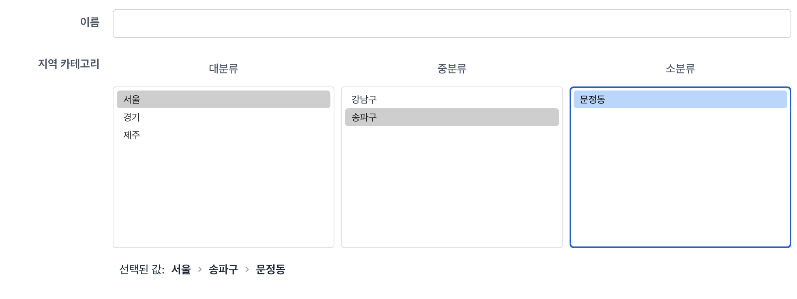

### HTTP 파일 업로드 결과를 테이블이나 이미지로 확인하려면 어떻게 하나요?

HTTP 블록에서 `showResult: table`을 사용하면 API 응답을 테이블 형태로 표시할 수 있습니다. 파일 업로드 API가 반환한 이미지 URL을 확인하려면 컬럼에 `format: image`를 지정할 수 있습니다.

```yaml
- type: http
  axios:
    method: POST
    url: https://example.com/api/upload
    headers:
      Content-Type: multipart/form-data
  params:
    - key: file
      format: file
      id: multipartFileRequest
  rowsPath: result
  showResult: table
  columns:
    object_url:
      format: image
      copy: true
    file:
      hidden: true
    name:
      format: template
      template: |
        <a href="{{object_url}}" target="_blank">{{name}}</a>
```

응답 구조가 예제와 다르면 `rowsPath`와 `columns`를 실제 API 응답에 맞춰 수정해 주세요. `showResultTemplate`을 이용해 테이블 대신 사용자 지정 표시 형식을 구성하는 방법도 원문에서 안내합니다.

### 파라미터 값에 따라 데이터베이스 리소스를 동적으로 선택하려면 어떻게 하나요?

`resource`에 `valueFromRow`와 `options`를 지정하면 하나의 블록에서 선택된 파라미터 값에 따라 리소스를 바꿀 수 있습니다.

```yaml
resource:
  valueFromRow: shopDb
  options:
    - seoul-shop
    - busan-shop
    - jeju-shop
```

화면에 표시되는 지역명과 실제 리소스 이름이 다르다면 `match`와 `value`를 사용해 연결할 수 있습니다.

```yaml
resource:
  valueFromRow: region
  options:
    - match: 서울지점
      value: seoul-branch-db
    - match: 부산지점
      value: busan-branch-db
```

사용자가 선택할 수 있는 값과 실제 연결 리소스가 일치하는지 확인해 주세요. 연결되지 않은 리소스를 선택할 수 없도록 입력 옵션도 함께 관리하는 것이 좋습니다.

### 데이터베이스의 UTC 날짜를 한국 시간으로 표시하려면 무엇을 확인해야 하나요?

날짜·시간 표시 방식은 데이터베이스의 타임존과 컬럼의 `formatFn` 설정에 따라 달라질 수 있습니다. 원문에서는 다음 차이를 설명합니다.

- 별도 옵션이 없으면 로컬 타임존으로 표시
- `formatFn: datetime`은 원본 값으로 표시
- `formatFn: datetime-local`은 로컬 타임존으로 표시

```yaml
columns:
  created_at:
    formatFn: datetime
  updated_at:
    formatFn: datetime-local
```

MySQL에서는 `@@global.time_zone`, `@@session.time_zone` 등을 조회해 데이터베이스 타임존을 확인할 수 있습니다. 실제 저장값과 화면 표시값을 비교해 UTC/KST 변환이 중복 적용되지 않는지 확인해 주세요.

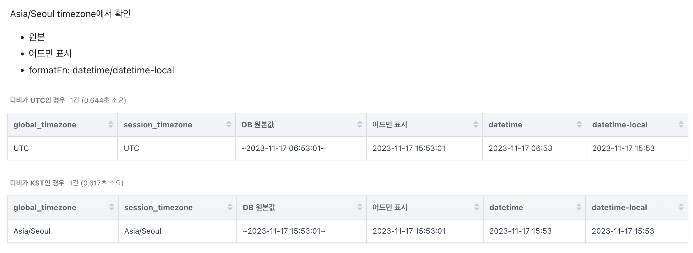

### 날짜 검색 기간을 최대 180일로 제한하려면 어떻게 하나요?

`requestSubmitFn`에서 시작일과 종료일의 차이를 계산하고, 제한을 초과하면 오류를 발생시켜 요청을 중단할 수 있습니다.

```yaml
requestSubmitFn: |
  const start = new Date(query2.params.created_at1.value)
  const end = new Date(query2.params.created_at2.value)
  const days = (end - start) / (1000 * 60 * 60 * 24)

  if (days > 180) {
    throw new Error('조회 기간은 180일까지 가능합니다.')
  }

  return true
```

원문에서는 숨겨진 보조 블록의 파라미터를 참조하는 예제를 사용합니다. 위 코드는 핵심 날짜 차이 검사만 간추린 형태이므로, 실제 페이지에서는 파라미터 키와 날짜 입력 형식을 맞춰 적용해 주세요.

### INSERT 후 생성된 ID를 responseFn에서 확인하려면 어떻게 하나요?

INSERT 요청의 결과는 `responseFn`에서 `data.result.insertId`로 확인할 수 있다고 원문에서 안내합니다.

```yaml
responseFn: |
  console.log('Fields:', data.fields)
  console.log('ID:', data.result.insertId)
```

생성된 ID를 제출 후 이동 경로에 사용하려면 `redirectAfterSubmit`을 활용하는 예제도 있습니다.

```yaml
redirectAfterSubmit: "#{{insertId}}"
```

실제 응답 객체의 구조는 사용하는 리소스와 드라이버에 따라 다를 수 있으므로 콘솔 로그에서 결과 구조를 확인해 주세요.

### 기존 레코드의 값을 가져와 새 레코드 작성 폼의 기본값으로 사용하려면 어떻게 하나요?

기존 콘텐츠를 조회한 뒤 `defaultValueFromRow`를 사용하면 모달의 입력 필드에 선택한 행의 값을 기본값으로 채울 수 있습니다.

```yaml
columns:
  id:
    openModal: detail-:id
modals:
  - path: detail-:id
    mode: side
    blocks:
      - type: http
        axios:
          method: POST
          url: https://example.com/api/posts
        params:
          - key: title
            defaultValueFromRow: title
          - key: description
            defaultValueFromRow: description
            format: textarea
            rows: 15
        display: form
```

이 방식은 기존 값을 참고해 새 게시물이나 알림을 작성하는 화면 등에 활용할 수 있습니다. 실제 저장 요청은 사용하는 API의 필드와 방식에 맞게 구성해 주세요.

### 쿼리 실행 전 확인 팝업을 생략하고 결과 메시지를 표시하려면 어떻게 하나요?

`confirm: false`를 설정하면 실행 전 확인 팝업을 표시하지 않을 수 있습니다. 실행 결과는 `toast`에 응답 필드를 넣어 안내할 수 있습니다.

```yaml
- type: query
  resource: mysql.qa
  sqlType: insert
  sql: |
    INSERT INTO stock_wine (code)
    VALUES (:code)
  params:
    - key: code
  confirm: false
  toast: |
    완료
    affectedRows: {{affectedRows}}
    insertId: {{insertId}}
```

확인 팝업을 생략하면 사용자가 실행 여부를 다시 확인하지 않고 요청이 처리됩니다. 삭제나 대량 변경처럼 되돌리기 어려운 작업에는 신중하게 적용해 주세요.

### 모달에서 선택한 값을 부모 화면의 파라미터로 전달하려면 어떻게 하나요?

모달 안의 테이블 컬럼에서 `updateParams`를 사용하면 선택한 행의 값을 부모 화면 파라미터에 반영할 수 있습니다.

```yaml
columns:
  작업:
    prepend: true
    value: 적용
    updateParams:
      si_do: "{{si_do}}"
      si_gu_gun: "{{si_gu_gun}}"
```

모달 안에 탭이나 여러 블록이 있고 부모 행의 여러 값을 전달해야 한다면 `modals`와 `valueFromRow`를 함께 사용하는 방법을 검토해 주세요. 원문 답변에서는 `viewModal`은 단순히 `id` 필드를 모달로 전달하는 용도에 적합하며, 복잡한 구성에는 `modals`를 권장합니다.

```yaml
columns:
  id:
    openModal: detail-:id
modals:
  - path: detail-:id
    blocks:
      - type: tab
        tabOptions:
          autoload: 1
          tabs:
            - name: 상세 정보
              blocks:
                - type: query
                  resource: mysql.qa
                  sqlType: select
                  sql: SELECT * FROM properties WHERE id = :id
                  params:
                    - key: id
                      valueFromRow: id
```

### 입력값에 따라 다른 파라미터를 숨기거나 비활성화하려면 어떻게 하나요?

`validateFn`에서 다른 파라미터 객체를 찾아 `hidden` 또는 `disabled` 값을 변경할 수 있습니다.

선택값에 따라 다른 입력 항목을 숨기는 예시입니다.

```yaml
params:
  - key: input1
    radio:
      - 활성화
      - 비활성화
    validateFn: |
      const target = params.find(e => e.key === 'input1_sub1')
      target.hidden = param.value === '활성화'
      return true
  - key: input1_sub1
    hidden: true
```

값에 따라 입력을 비활성화하려면 다음처럼 `disabled`를 변경할 수 있습니다.

```yaml
validateFn: |
  const reason = params.find(e => e.key === 'reason')
  reason.disabled = Number(param.value) <= 10
  return true
```

실제 조건과 초기 상태에 맞춰 `hidden` 또는 `disabled`를 선택해 주세요.

### 메뉴 항목 옆에 건수 배지를 표시하려면 어떻게 하나요?

메뉴의 `badgeOptions`를 사용하면 쿼리 결과나 API 값 등을 메뉴 옆 배지로 표시할 수 있습니다. `enabled`를 활성화하고 `postfix`와 `color`를 지정할 수 있습니다.

```yaml
menus:
  - path: pages/orders
    name: 주문 관리
    badgeOptions:
      enabled: true
      type: query
      resource: mysql.qa
      sql: |
        SELECT COUNT(id) FROM orders
      postfix: 건
      color: green
```

원문에서는 값이 0인 경우 배지가 표시되지 않는다고 안내합니다. 색상은 Tailwind CSS 계열 색상 이름을 사용할 수 있다고 소개되어 있습니다.

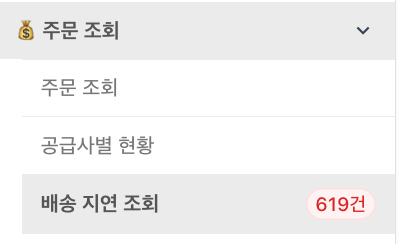

### HTTP API 응답을 datalistFromQuery의 선택 목록으로 사용하려면 어떻게 하나요?

`datalistFromQuery` 안에서 `type: http`를 사용하면 API 응답을 선택 목록으로 활용할 수 있습니다. 응답을 `responseFn`으로 가공해 `value`와 `label`을 반환하도록 구성할 수 있습니다.

```yaml
params:
  - key: item
    label: 아이템
    datalist: true
    datalistFromQuery:
      type: http
      axios:
        method: GET
        url: https://example.com/api/products
      rowsPath: rows
      responseFn: |
        return rows.map(item => ({
          value: item.id,
          label: item.name
        }))
```

원문에서는 응답이 완전한 리스트이거나 `key`, `value` 쌍으로 구성되어야 한다고 안내합니다. API의 실제 응답 구조에 따라 `rowsPath`와 변환 코드를 수정해 주세요.

### 커스텀 도메인에서 네이버 지도가 인증 오류로 표시되면 어떻게 하나요?

원문에서는 네이버 지도 API가 Naver Cloud Platform Maps API로 전환된 이후, 기본 도메인 외의 커스텀 도메인에서 인증 오류가 발생할 수 있는 사례를 설명합니다. 이 경우 커스텀 도메인을 허용하는 NCP Application을 발급하고 `mapOptions.ncpKeyId`에 키 ID를 지정하는 방법을 안내합니다.

```yaml
mapOptions:
  zoom: 15
  zoomControl: true
  ncpKeyId: "NCP_APPLICATION_KEY_ID"
```

NCP 콘솔에서 발급한 Web URL 허용 설정이 실제 서비스 도메인과 일치해야 합니다. 키 값과 허용 도메인은 각자의 NCP 프로젝트 설정에 맞게 등록해 주세요.

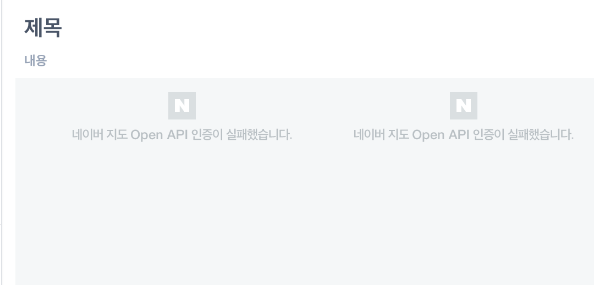
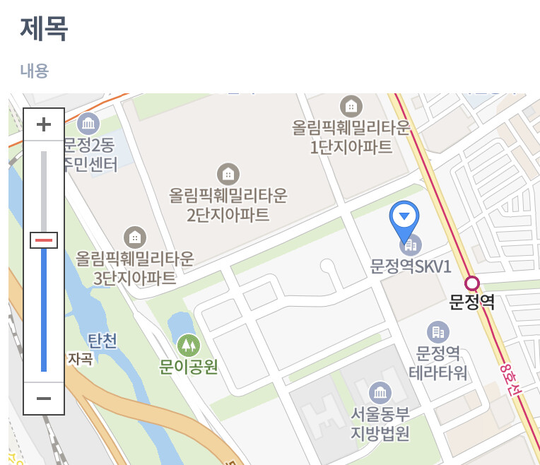

### YAML 앵커와 병합 키로 공통 설정을 재사용하려면 어떻게 하나요?

YAML 앵커(`&`)와 별칭(`*`)을 사용하면 공통 설정을 한 번 정의하고 여러 위치에서 재사용할 수 있습니다. 병합 키(`<<`)를 사용하면 공통 설정을 가져온 뒤 일부 값을 추가하거나 덮어쓸 수 있습니다.

```yaml
columns: &columns
  id:
    hidden: true
  start_date:
    formatFn: date

blocks: &base_block
  type: query
  resource: database.example
  sqlType: select
  columns: *columns

pages:
  - path: customers
    blocks:
      - <<: *base_block
        sql: SELECT * FROM customers
      - <<: *base_block
        sql: SELECT * FROM active_customers
```

`*base_block`은 정의한 값을 재사용하고, `<<: *base_block`은 공통 설정을 새 항목에 병합하는 예시입니다. 앵커 이름과 별칭이 일치하는지, 병합 후 최종 YAML 구조가 의도한 형태인지 확인해 주세요.

### JSON 배열 안의 값에 따라 테이블 컬럼 색상을 지정하려면 어떻게 하나요?

`columns`의 `color`에 값과 색상 이름을 매핑하면 JSON 배열 안의 태그 값에 따라 색상을 지정할 수 있습니다. 원문 예제에서는 `tags` 컬럼을 텍스트 형태로 표시하고 각 태그에 색상을 연결합니다.

```yaml
columns:
  tags:
    type: text
    label: 태그
    color:
      패션: red
      스포츠: blue
      전자기기: green
      스마트폰: purple
      서적: orange
```

컬럼 값과 색상 매핑의 키가 일치해야 합니다.

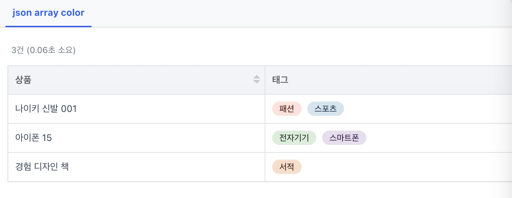

### Chart.js를 사용해 조회 결과를 사용자 지정 차트로 표시하려면 어떻게 하나요?

`display: chartjs`와 `displayFn`을 사용하면 조회 결과를 Chart.js 데이터 구조로 가공해 차트를 표시할 수 있습니다. 원문에서는 `rows`, `id`, `openModal`, `openAction`, `_` 등을 `displayFn` 안에서 활용할 수 있다고 설명합니다.

간단한 도넛 차트 예시는 다음과 같습니다.

```yaml
display: chartjs
displayFn: |
  const totals = {}
  rows.forEach(row => {
    totals[row.category] = (totals[row.category] || 0) + row.revenue
  })

  const data = {
    labels: Object.keys(totals),
    datasets: [{
      data: Object.values(totals)
    }]
  }

  new Chart(ctx, {
    type: 'doughnut',
    data,
    options: { responsive: true }
  })
```

`displayFn`에서 차트를 그릴 때는 블록의 `id`와 차트 컨텍스트가 연결되는지 확인해야 합니다. 원문은 Chart.js의 도넛·레이더·버블 차트 예제를 포함하고 있으며, 실제 차트 옵션은 필요한 시각화에 맞게 조정해야 합니다.

### 레이아웃의 상단 메뉴·사이드 메뉴·탭 메뉴 스타일을 변경하려면 어떻게 하나요?

`layout` 설정에서 `topMenu`, `leftMenu`, `tabMenu`, `page`의 클래스와 스타일을 지정할 수 있습니다. 로고 영역을 직접 구성할 때는 `logoTemplate`을 사용할 수 있습니다.

```yaml
layout:
  leftMenu:
    containerClass: bg-slate-50 border-r border-slate-200 text-slate-600
    containerStyle:
      width: 250px
    itemClass: text-sm font-bold rounded-lg
  tabMenu:
    containerClass: bg-white text-slate-600 font-bold text-sm px-3
  page:
    contentClass: p-6
  topMenu:
    containerClass: fixed w-screen z-30 bg-white border-b px-2
    logoTemplate: |
      <div class="flex items-center gap-2 p-2">
        
        <div class="text-sm font-semibold">Admin</div>
      </div>
```

원문 예제는 Tailwind CSS 클래스를 사용해 메뉴와 페이지의 스타일을 조정합니다. 외부 스크립트나 이미지 URL을 추가하는 경우 해당 리소스의 접근 가능 여부와 보안 정책을 확인해 주세요.

## 추가 실전 활용

### Markdown 블록에 Tailwind 클래스를 적용해 안내 문구를 꾸미려면 어떻게 하나요?

Markdown 블록의 `class` 또는 `style`을 사용해 본문과 구분되는 안내 영역을 만들 수 있습니다. 예를 들어 작은 회색 글씨로 설명을 표시하려면 다음과 같이 작성합니다.

```yaml
- type: markdown
  class: text-sm text-slate-500
  content: |
    이 영역에 페이지 사용 방법이나 안내 문구를 작성합니다.
```

`class`에는 Tailwind CSS 클래스를, `style`에는 필요한 인라인 스타일을 지정할 수 있습니다. 실제로 사용할 수 있는 클래스와 스타일은 화면 환경에 맞춰 확인해 주세요.


### 일반 사용자에게 사용자 프로퍼티 입력 화면을 제공하려면 어떻게 하나요?

`userProperty` 블록을 사용하면 관리자 권한이 없는 사용자에게도 지정한 사용자 프로퍼티를 입력하도록 구성할 수 있습니다. 계정 설정 화면에 직접 접근하지 않고 어드민 페이지 안에서 사용자별 속성을 입력해야 할 때 활용할 수 있습니다.

```yaml
blocks:
  - type: userProperty
    roles:
      edit:
        - 계정관리
    properties:
      shopCode:
        type: string
        placeholder: 상점코드
      shopId:
        type: string
        label: 상점 ID
        placeholder: 상점 ID를 입력해주세요.
```

`roles.edit`에는 수정 권한을 부여할 권한 그룹을 지정하고, `properties`에는 사용자가 수정할 수 있는 필드와 입력 형식을 정의합니다. 원문 안내에서는 특정 플랜 이상에서 제공되는 기능으로 설명되어 있으므로, 현재 이용 중인 플랜의 지원 여부를 확인해야 합니다.

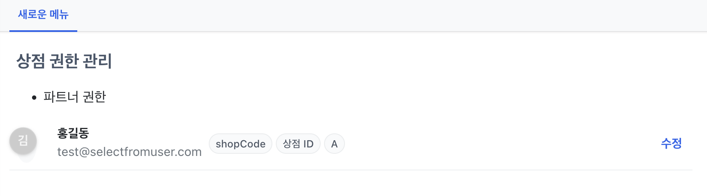

### HTTP/2를 사용하는 API에 요청하려면 어떻게 하나요?

커뮤니티에서 공유된 예제에서는 기본 HTTP 요청 대신 `got` 클라이언트를 사용하고 `http2: true`를 지정해 HTTP/2 요청을 보냈습니다.

```yaml
- type: http
  got:
    url: https://example.com/api
    method: GET
    http2: true
  columns:
    headers:
      format: table
```

이 예제는 당시 추가된 `got` 클라이언트 설정을 기준으로 합니다. 현재 배포 버전에서 `got` 및 `http2` 옵션을 지원하는지 확인한 뒤 적용해 주세요. HTTP/2 전용 서버에 연결할 때는 서버의 인증서와 네트워크 정책도 함께 확인해야 합니다.

### 테이블의 너비, 테두리, 행 색상과 스크롤 영역을 조정하려면 어떻게 하나요?

테이블은 `tableOptions`, `containerClass`, `containerStyle`, `headerClass`, `rowClass`, `rowActiveClass` 등을 조합해 표시 형태를 조정할 수 있습니다.

```yaml
display: table
tableOptions:
  style:
    cellWidth: 150px
  containerClass: overflow-auto border shadow-sm rounded
  containerStyle:
    height: 300px
    width: 100%
headerClass: sticky top-0 z-10 bg-white
rowClass: even:bg-zinc-100/50
rowActiveClass: bg-slate-100 shadow
```

- `cellWidth`: 셀 너비를 지정합니다.
- `containerClass`, `containerStyle`: 테이블 바깥 영역의 테두리, 스크롤 및 크기를 조정합니다.
- `headerClass`: 스크롤 시 헤더를 고정하는 스타일을 지정합니다.
- `rowClass`: 행의 기본 스타일이나 홀수·짝수 행의 배경색을 지정합니다.
- `rowActiveClass`: 선택되거나 활성화된 행의 스타일을 지정합니다.

테이블 전체 높이를 유지하고 페이지 번호를 하단에 고정하려면 다음과 같이 설정할 수도 있습니다.

```yaml
display: table
paginationOptions:
  enabled: true
  perPage: 30
  fixed: true
```

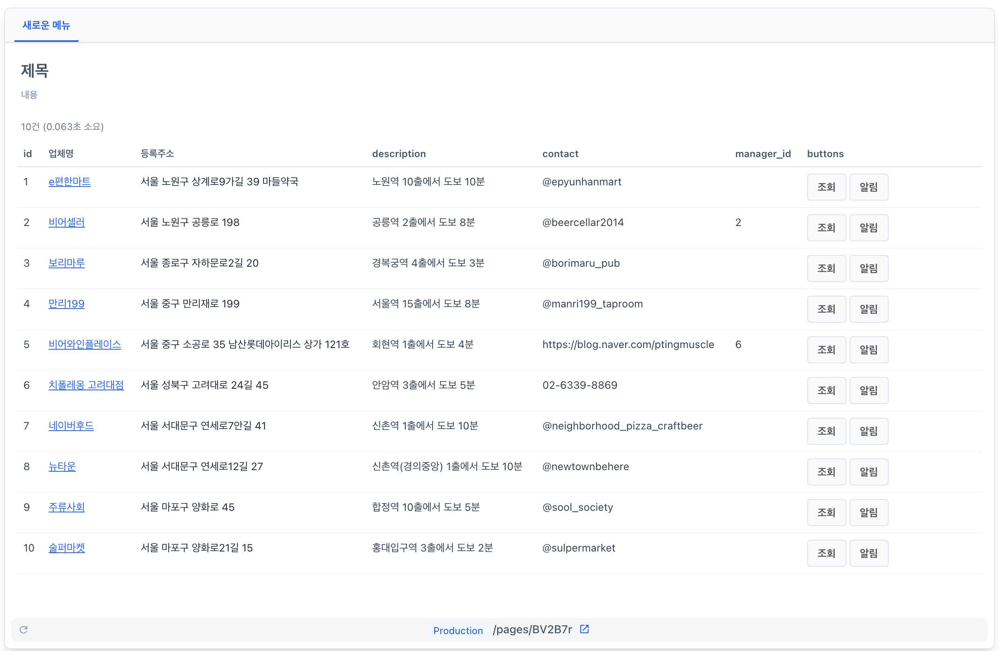
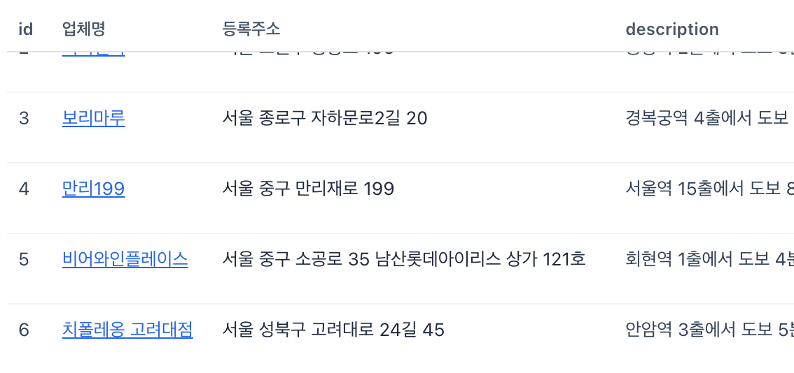
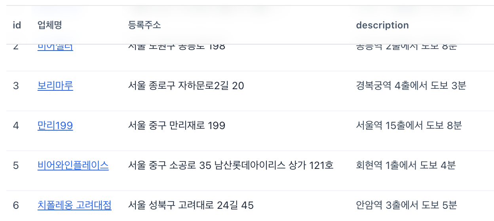

### MongoDB에서 queryFn으로 조건을 조합해 조회하려면 어떻게 하나요?

MongoDB 리소스에서는 `queryFn`을 사용해 JavaScript로 조회 조건을 구성할 수 있습니다. 파라미터의 `key`는 `queryFn` 안에서 같은 이름의 변수로 사용할 수 있습니다.

```yaml
- type: query
  resource: mongodb
  sqlType: select
  query:
    collection: properties
  queryFn: |
    const where = {}

    if (_id) where._id = ObjectId(_id)
    if (name) where.name = { $regex: name }

    if (paid_at1 && paid_at2) {
      where.paid_at = {
        $gte: new Date(paid_at1),
        $lte: new Date(paid_at2)
      }
    }

    properties.find(where).toArray()
  params:
    - key: _id
    - key: name
    - key: paid_at
      format: date
      range: true
```

여러 조건을 선택적으로 추가한 뒤 `find(where).toArray()`로 결과를 가져오는 방식입니다. 실제 컬렉션명, 필드명, ObjectId 사용 여부는 데이터 구조에 맞게 변경해야 합니다.

### MongoDB의 배열 또는 중첩 문서 값을 테이블 컬럼으로 표시하려면 어떻게 하나요?

MongoDB 조회 결과에 중첩 문서나 배열이 포함되어 있다면 `responseRowFn`에서 각 행의 값을 가공해 테이블에 표시할 수 있습니다.

배열 안의 `name` 값을 하나의 문자열로 합치는 예제입니다.

```yaml
- type: query
  resource: mongodb
  sqlType: select
  query:
    collection: nested
    find: {}
    projection:
      _id: 1
      data: 1
  responseRowFn: |
    row.data = row.data.embed.name.map(e => e).join(', ')
```

배열의 각 요소를 개별 행으로 펼쳐야 하는 경우에는 MongoDB의 aggregation에서 `$unwind`와 `$group`을 활용할 수 있습니다. 원본 데이터의 실제 중첩 구조에 따라 접근 경로를 조정해야 합니다.

### MySQL JSON 배열의 특정 인덱스 값을 수정하려면 어떻게 하나요?

`JSON_SET`의 JSON 경로에 파라미터를 직접 넣으면 숫자 인덱스가 문자열로 치환되어 의도한 경로로 처리되지 않을 수 있습니다. 이 경우 `CONCAT()`으로 JSON 경로를 조합할 수 있습니다.

```sql
UPDATE your_table
SET detail = JSON_SET(
  detail,
  CONCAT('$[', :idx, ']'),
  :value
)
WHERE id = :id;
```

`:idx`에는 배열 인덱스, `:value`에는 변경할 값을 전달합니다. 테이블명과 조건은 실제 데이터 구조에 맞게 수정하고, 운영 데이터에 적용하기 전에 대상 행과 변경 결과를 확인해 주세요.

### 날짜별 지표를 월·주·일 단위로 집계하고 증감률을 표시하려면 어떻게 하나요?

날짜별 데이터를 SQL로 집계한 뒤 `chartOptions`의 `daily`, `weekly`, `monthly`, `sampleBy`, `formatter` 옵션을 조합해 차트에 표시할 수 있습니다.

```yaml
- type: query
  resource: mysql.qa
  sqlType: select
  sql: >
    SELECT
      DATE_FORMAT(created_at, '%Y-%m-%d') AS date,
      COUNT(id) AS count
    FROM UserStageLog
    WHERE created_at BETWEEN :date1 AND :date2
    GROUP BY DATE_FORMAT(created_at, '%Y-%m-%d')
  chartOptions:
    type: bar
    x: date
    y:
      - count
    daily: false
    weekly: false
    monthly: true
    sampleBy: sum
    options:
      plugins:
        datalabels:
          anchor: end
          align: end
          formatter: percentage-diff
```

그래프에 레이블이 많으면 `rotation`, `font.size`, `color` 등의 차트 옵션으로 표시를 조정할 수 있습니다. 날짜 집계 기준과 증감률의 비교 기간은 실제 지표 정의에 맞게 확인해야 합니다.

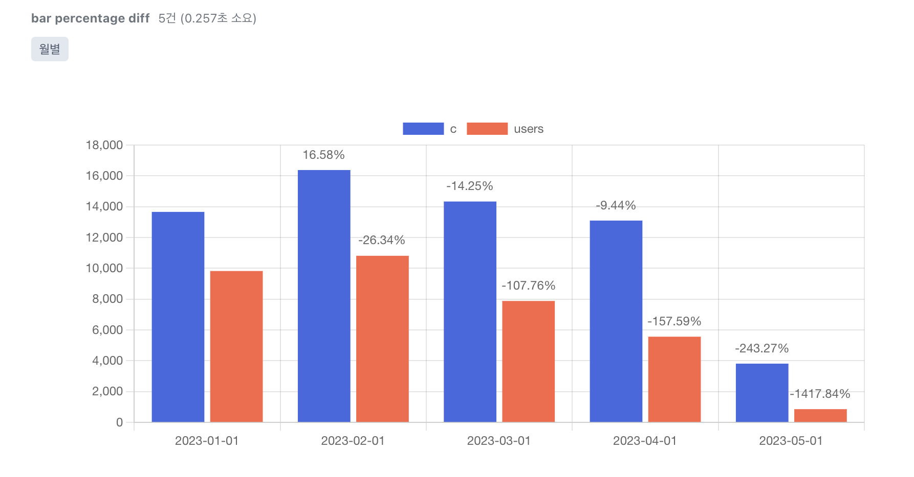

### 데이터 수정 전에 변경 사유를 입력받으려면 어떻게 하나요?

수정 요청을 실행하기 전에 사용자에게 변경 사유를 입력받으려면 `prompt: true`를 설정할 수 있습니다. 원문에서는 조회가 아닌 데이터를 변경하는 query 및 HTTP API 요청에 사용하는 예제를 공유했습니다.

```yaml
- type: query
  resource: mysql.qa
  sqlType: update
  sql: |
    UPDATE wine_stock
    SET name = :name
    WHERE id = :id
  prompt: true
  promptComments:
    - 고객요청
    - 파기
  params:
    - key: id
      value: 1
    - key: name
      value: 변경할 이름
```

`promptComments`에는 사유 선택 항목을 지정할 수 있습니다. 실제 변경 이력이 어디에 어떤 형식으로 저장되는지는 사용 중인 환경에서 확인해 주세요.

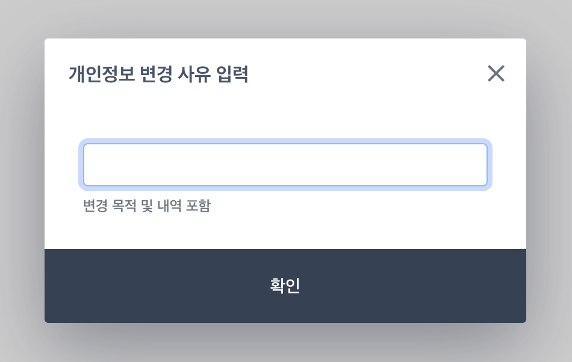

### S3 Presigned URL을 이용해 파일을 자체 스토리지에 업로드하려면 어떻게 하나요?

자체 S3 버킷에 파일을 저장하려면 서버에서 Presigned URL 또는 업로드용 서명 정보를 발급하고, 브라우저에서 해당 정보로 파일을 전송하는 방식으로 구성할 수 있습니다.

아래는 커뮤니티에서 공유된 흐름을 간략화한 예제입니다.

```yaml
params:
  - key: file
    format: file
    id: thumbnail
requestSubmitFn: |
  const file = document.querySelector('#thumbnail').files[0]
  if (!file) throw new Error('업로드할 파일을 선택해주세요.')

  // 서버에서 S3 업로드용 서명 정보를 발급받습니다.
  const response = await fetch('/generate-presigned-url', {
    method: 'GET'
  })
  if (!response.ok) throw new Error('업로드 주소를 발급받지 못했습니다.')

  const result = await response.json()
  const { url, fields } = result[0]

  const formData = new FormData()
  Object.entries(fields).forEach(([key, value]) => {
    formData.append(key, value)
  })
  formData.append('Content-Type', file.type)
  formData.append('file', file)

  const uploadResponse = await fetch(url, {
    method: 'POST',
    body: formData
  })
  if (!uploadResponse.ok) throw new Error('파일 업로드에 실패했습니다.')

  return true
```

`/generate-presigned-url`은 예시 경로이므로 실제 서명 발급 API로 바꿔야 합니다. 서명 정보와 업로드 정책은 서버에서 생성하고, 비밀 키를 브라우저 코드나 YAML에 직접 넣지 마세요. 업로드가 성공한 뒤 반환된 파일 경로나 URL을 데이터베이스에 저장하는 처리도 별도로 구성해야 합니다.

### 파일 입력에서 여러 파일을 선택하려면 어떻게 하나요?

파일 파라미터에 `multiple: true`를 지정하면 여러 파일을 선택할 수 있습니다.

```yaml
params:
  - key: file
    format: file
    multiple: true
    accept: image/*
```

`accept`에는 허용할 파일 형식을 지정합니다. 여러 파일을 실제로 저장하거나 외부 스토리지에 업로드하는 처리는 사용하는 API와 업로드 방식에 맞게 별도로 구성해야 합니다.

### API 응답에 포함된 여러 이미지 URL을 화면에 표시하려면 어떻게 하나요?

API 응답의 배열에 이미지 URL이 들어 있다면 `responseFn`에서 URL마다 하나의 행을 만들어 테이블의 이미지 컬럼으로 표시할 수 있습니다.

```yaml
- type: http
  axios:
    method: GET
    url: https://example.com/api/images
  responseFn: |
    const imageUrls = rows[0].imageUrls || []
    return imageUrls.map((url, index) => ({
      value: index,
      label: `Image ${index + 1}`,
      image_url: url
    }))
  columns:
    image_url:
      format: image
      width: 400px
      height: 120px
      thumbnail: true
      thumbnailWidth: 100px
      flex: true
```

응답 구조가 `{ imageUrls: [...] }`가 아니라면 `rows[0].imageUrls` 부분을 실제 응답 필드에 맞춰 변경해 주세요.

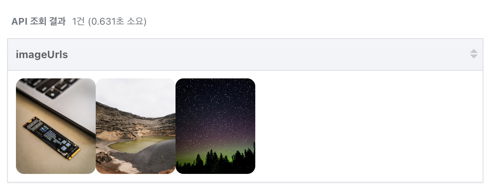

### 숫자 입력 필드와 테이블에 색상 값을 입력하고 표시하려면 어떻게 하나요?

색상 값을 입력할 때는 파라미터에 `format: color`를 지정하고, 조회 결과를 표시할 때는 컬럼에도 `format: color`를 지정할 수 있습니다.

```yaml
params:
  - key: hex
    format: color
```

```yaml
columns:
  hex:
    format: color
```

데이터베이스에는 색상 값을 저장하고, 조회 화면에서 같은 필드에 색상 형식을 적용하는 방식입니다.

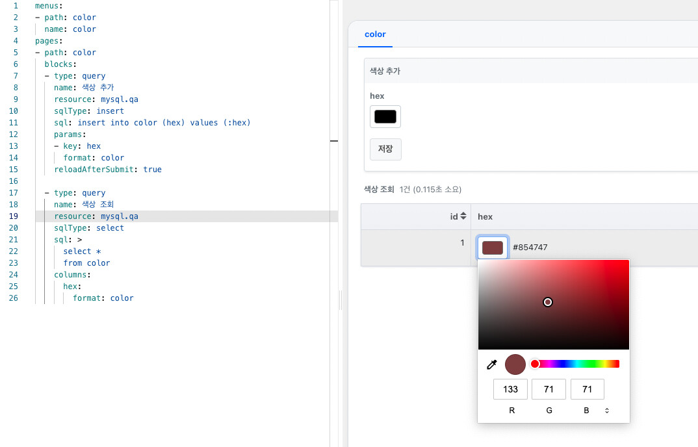

### MariaDB의 BIT 타입을 읽기 쉬운 값으로 표시하려면 어떻게 하나요?

MariaDB를 MySQL 리소스로 연결했을 때 `BIT` 타입 값이 화면에서 기대한 형태로 표시되지 않는다면 `EXPORT_SET()`을 사용해 문자열로 변환하는 방법이 공유되었습니다.

```sql
SELECT EXPORT_SET(bit_test, '1', '0', '', 1) AS bit_test
FROM your_table;
```

`EXPORT_SET(bits, on, off, separator, number_of_bits)`는 각 비트에 대응하는 값을 문자열로 만듭니다. 예제의 컬럼명과 비트 수는 실제 데이터에 맞게 변경해 주세요.

### 날짜뿐 아니라 시간 또는 날짜와 시간을 입력받으려면 어떻게 하나요?

파라미터의 `format`을 입력 목적에 맞게 지정합니다.

```yaml
params:
  - key: work_time
    format: time

  - key: reservation_at
    format: datetime-local
```

날짜만 입력받을 때는 `format: date`를 사용합니다. 데이터베이스에 저장할 때는 애플리케이션과 데이터베이스의 시간대 및 저장 형식이 일치하는지 확인해 주세요.

### 조회한 데이터의 카테고리별 비율을 Metric 형태로 표시하려면 어떻게 하나요?

`display: metric`과 `metricOptions.type: category`를 사용하면 그룹별 건수와 전체 합계를 카테고리 형태로 표시할 수 있습니다.

```yaml
- type: query
  resource: mysql.qa
  sqlType: select
  sql: >
    SELECT type, COUNT(id) AS count
    FROM properties
    WHERE type IS NOT NULL
    GROUP BY type
    ORDER BY count DESC
  display: metric
  metricOptions:
    type: category
    name: type
    value: count
    total: 타입 분포
```

고정된 이름을 순서대로 표시하는 경우에는 `names` 배열을 사용할 수 있습니다. 이때 SQL 결과의 정렬 순서와 `names` 배열의 순서가 일치해야 합니다.

### 여러 개의 BarList 지표를 한 화면에 표시하려면 어떻게 하나요?

`display: metric`과 `metricOptions.type: bar`를 사용하면 카테고리별 값을 막대 목록 형태로 표시할 수 있습니다.

```yaml
- type: query
  resource: mysql.qa
  sqlType: select
  sql: >
    SELECT COALESCE(type, 'NONE') AS source,
           COUNT(id) AS visits
    FROM properties
    GROUP BY type
    ORDER BY visits DESC
  display: metric
  metricOptions:
    type: bar
    name: source
    value: visits
    nameLabel: Source
    valueLabel: Visits
    total: 전체 방문
```

조회 결과에서 `name`과 `value`로 사용할 필드를 지정하고, 필요하면 `href`를 추가해 항목 클릭 시 상세 페이지로 이동하도록 구성할 수 있습니다.

### 선형 차트의 점을 숨기고 선을 부드럽게 표시하려면 어떻게 하나요?

선형 차트의 `datasetOptions`에서 `pointStyle`과 `tension`을 조정할 수 있습니다.

```yaml
chartOptions:
  height: 200px
  type: line
  x: date
  y: UPB
  borderWidth: 2
  borderColor:
    UPB: RoyalBlue
  datasetOptions:
    cubicInterpolationMode: monotone
    pointStyle: false
    tension: 0.4
```

`pointStyle: false`는 데이터 포인트 표시를 끄고, `tension`은 선의 곡률을 조정합니다. 곡선을 부드럽게 만들수록 실제 데이터의 급격한 변화가 시각적으로 완만하게 보일 수 있으므로 해석에 유의해 주세요.

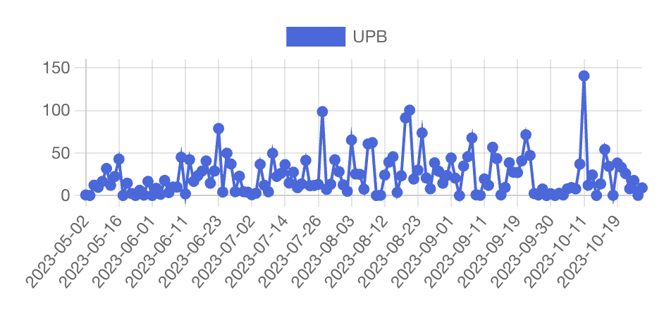

### 테이블에서 선택한 행의 값을 테이블 위에 표시하려면 어떻게 하나요?

`selectOptions.template`에서 `tableSelectedRows`를 사용하면 선택된 행의 값을 테이블 위쪽에 표시할 수 있습니다.

```yaml
selectOptions:
  enabled: true
  template: |
    `선택됨: ${tableSelectedRows.map(row => row.name).join(', ')}`
```

선택된 행의 ID를 표시하려면 `row.id`를 사용하고, 이름이나 다른 필드를 표시하려면 실제 조회 결과의 필드명으로 바꿔 주세요.

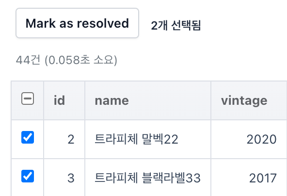
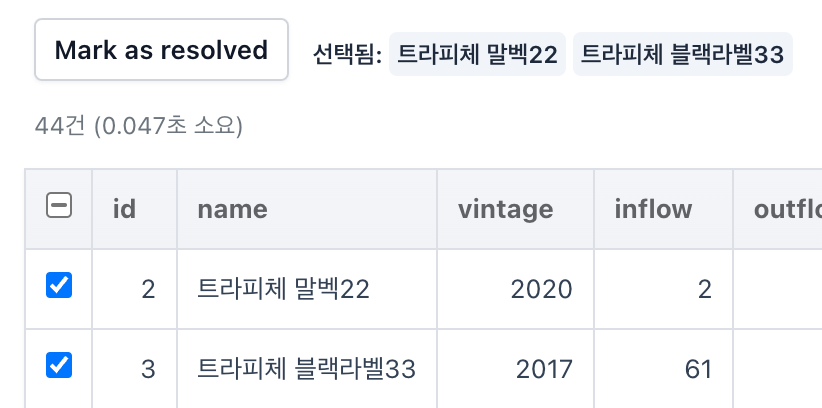

### 브라우저 localStorage를 요청 함수에서 사용하려면 어떻게 하나요?

`requestFn` 또는 `responseFn`에서 브라우저의 `localStorage`를 사용할 수 있습니다. 예를 들어 키를 저장하고 이미 존재하는 경우 중복 발급을 막는 흐름은 다음과 같습니다.

```yaml
responseFn: |
  localStorage.setItem('TEST_KEY', '1234')
  return rows
```

값을 읽을 때는 `localStorage.getItem('TEST_KEY')`, 삭제할 때는 `localStorage.removeItem('TEST_KEY')`를 사용할 수 있습니다. `localStorage`는 브라우저에 저장되므로 민감한 인증 토큰이나 비밀 키를 보관하지 마세요. 사용자가 브라우저 데이터를 삭제하면 저장값도 사라질 수 있습니다.

### SQL 조회 결과와 HTTP API 조회 결과를 결합해 테이블에 표시하려면 어떻게 하나요?

한 블록의 SQL 결과를 기준으로 다른 HTTP 블록의 데이터를 조회한 다음 `responseFn`에서 두 결과를 연결할 수 있습니다.

```yaml
- type: http
  id: getProducts
  autoload: false
  axios:
    method: GET
    url: https://example.com/api/products

- type: query
  resource: mysql.qa
  sqlType: select
  sql: |
    SELECT id, name, vintage
    FROM wine_stock
  responseFn: |
    const result = await getProducts.trigger()
    const products = result?.rows || []

    return rows.map(row => {
      const product = products.find(item => item.id == row.id) || {}
      return {
        ...row,
        external_name: product.name
      }
    })
```

예제에서는 SQL 결과의 `id`와 API 결과의 `id`를 기준으로 연결해 API에서 가져온 `name`을 `external_name`으로 추가합니다. 실제 API 응답 경로와 키의 자료형에 맞춰 비교 조건을 수정해 주세요.

### 여러 개의 UPDATE 문을 하나의 Action에서 실행하려면 어떻게 하나요?

선택한 행마다 여러 SQL 문을 실행하려면 Action의 `params`에서 `valueFromSelectedRows`를 사용해 행 값을 전달할 수 있습니다.

```yaml
actions:
  - label: 승인
    type: query
    resource: mysql.qa
    sqlType: update
    confirmText: 승인하시겠어요?
    sql: |
      UPDATE stock_wine SET unit = 3 WHERE id = :id;
      UPDATE stock_wine SET unit = 3 WHERE id = 1 + :id;
    params:
      - key: id
        valueFromSelectedRows: id
```

여러 문장을 하나의 트랜잭션으로 처리하려면 데이터베이스에서 트랜잭션을 시작하고 모든 문장이 성공한 경우 커밋하도록 구성할 수 있습니다. 트랜잭션 사용 시 오류 발생 시 롤백 처리와 커밋 여부를 반드시 확인해 주세요.

### 선택한 여러 행의 값을 하나의 JSON 배열로 저장하려면 어떻게 하나요?

MySQL에서는 `JSON_ARRAY()`를 사용해 여러 행에서 선택한 값을 배열로 저장할 수 있습니다. 이 방식에서는 `forEach: true`를 사용하지 않아야 선택된 값들이 개별 실행으로 분리되지 않습니다.

```yaml
actions:
  - label: 저장
    type: query
    resource: mysql.qa
    sqlType: insert
    sql: |
      INSERT INTO properties (created_at, name)
      VALUES (NOW(), JSON_ARRAY(:name))
    params:
      - key: name
        valueFromSelectedRows: name
```

실제 컬럼 타입과 SQL 문은 저장할 테이블 구조에 맞게 변경해 주세요.

### 선택한 행을 두 개의 테이블 사이에서 이동시키려면 어떻게 하나요?

두 개의 조회 블록을 좌우 영역에 배치하고, 각 블록에서 선택한 행의 ID를 `valueFromSelectedRows`로 전달해 UPDATE를 실행할 수 있습니다.

```yaml
- type: left
  title: 호텔 리스트
  blocks:
    - type: query
      resource: mysql.qa
      sqlType: select
      sql: |
        SELECT id, type
        FROM properties
        WHERE type = 'HOTEL'
      selectOptions:
        enabled: true
      actions:
        - label: 이동
          type: query
          resource: mysql.qa
          sqlType: update
          sql: |
            UPDATE properties SET type = 'RESORT' WHERE id = :id
          params:
            - key: id
              valueFromSelectedRows: id
          forEach: true
          reloadAfterSubmit: true
```

반대쪽 블록에는 반대 방향의 UPDATE를 구성합니다. 여러 행을 한 번에 변경할 때는 `forEach: true`로 각 선택 행에 대해 요청이 실행되는 점을 확인해 주세요.

### 조회한 프로세스 목록에서 선택한 프로세스를 종료하려면 어떻게 하나요?

데이터베이스의 `SHOW PROCESSLIST` 결과를 테이블로 표시하고, 선택한 행의 프로세스 ID를 Action에 전달하는 관리 화면을 만들 수 있습니다.

```yaml
- type: query
  resource: tm_root
  sqlType: select
  sql: SHOW PROCESSLIST
  selectOptions:
    enabled: true
  actions:
    - label: 프로세스 종료
      type: query
      resource: tm_root
      sqlType: update
      sql: CALL mysql.rds_kill(:id)
      params:
        - key: id
          valueFromSelectedRows: Id
      forEach: true
      reloadAfterSubmit: true
```

프로세스 종료는 다른 사용자의 작업이나 서비스에 영향을 줄 수 있는 관리자 작업입니다. 권한이 있는 운영자만 사용할 수 있도록 제한하고, 종료 대상과 영향 범위를 확인한 뒤 실행해야 합니다. 위 예제의 `mysql.rds_kill`은 해당 환경에서 사용할 수 있는 프로시저인지 확인해 주세요.

### 조회 결과를 화면에 표시하지 않고 바로 CSV 또는 XLSX로 다운로드하려면 어떻게 하나요?

많은 데이터를 화면에 렌더링하지 않고 다운로드만 하려면 `downloadAfterSubmit: true`를 사용할 수 있습니다. 원문 안내에서는 `query`의 SELECT와 HTTP GET 요청에 사용하는 방식으로 설명했습니다.

```yaml
- type: query
  resource: mysql.qa
  sqlType: select
  sql: |
    SELECT * FROM test_10k
    WHERE id BETWEEN :from AND :to
  params:
    - key: from
      value: 1
    - key: to
      value: 5000
  autoload: false
  submitButton:
    label: 다운로드
  showDownload: csv xlsx
  downloadAfterSubmit: true
```

화면에서 조회 결과를 확인해야 한다면 이 옵션을 사용하지 않는 일반 다운로드 흐름을 사용합니다. 원문 안내에서는 자동 실행을 막기 위해 `autoload: false`를 함께 설정하도록 설명합니다.

### 테이블의 데이터만 다시 조회하는 새로고침 버튼을 표시하려면 어떻게 하나요?

페이지 전체가 아니라 특정 블록만 새로고침할 수 있도록 `showRefresh: true`를 설정할 수 있습니다.

```yaml
- type: query
  id: query1
  resource: mysql.qa
  sqlType: select
  sql: |
    SELECT * FROM properties
    WHERE id = :id
  params:
    - key: id
      value: 1
  showRefresh: true
```

블록에 마우스를 올렸을 때 새로고침 버튼이 표시되며, 버튼을 누르면 해당 블록의 데이터를 다시 조회합니다. 다른 블록도 함께 갱신해야 한다면 각 블록의 실행 흐름을 별도로 구성해야 합니다.

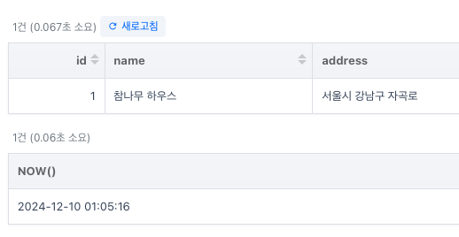

### display: form에서 컬럼의 값을 검색해 선택하고 수정하려면 어떻게 하나요?

`display: form`의 컬럼에 `updateOptions`와 `searchOptions`를 함께 구성하면 다른 테이블의 값을 검색해 선택한 뒤 업데이트하는 입력 흐름을 만들 수 있습니다.

```yaml
columns:
  assignee_id:
    label: 담당자
    updateOptions:
      type: query
      resource: mysql
      sqlType: update
      sql: |
        UPDATE bookings SET assignee_id = :value WHERE id = :id
      searchOptions:
        enabled: true
        type: query
        resource: mysql
        sqlType: select
        sql: |
          SELECT id AS value, name AS 이름, status AS 상태
          FROM assignees
          WHERE name LIKE CONCAT('%', :value, '%')
```

`searchOptions`의 조회 쿼리는 검색어에 맞는 선택 항목을 반환하도록 구성합니다. 원문에서는 베타 기능으로 소개된 내용이므로 현재 버전에서 지원되는 옵션과 사용 위치를 확인해 주세요.

### HTML 형식의 컬럼 높이를 지정하고 스크롤을 표시하려면 어떻게 하나요?

`format: html`을 사용하는 컬럼에 `style.height`와 `overflow: auto`를 지정하면 표시 영역의 높이를 조절하고 내용이 넘칠 때 스크롤을 표시할 수 있습니다.

```yaml
columns:
  body_html:
    format: html
    style:
      height: 200px
      overflow: auto
```

이 설정은 커뮤니티에서 보고된 최대 높이 고정 문제를 수정한 뒤 안내된 사용 예제입니다. 화면에서 높이가 반영되지 않는다면 최신 배포 버전인지 확인해 주세요.

### 컬럼 필터와 인라인 수정을 함께 사용할 때 예상하지 못한 드롭다운이 나타나면 어떻게 하나요?

`filterOptions`와 `updateOptions`를 같은 컬럼에 함께 설정했을 때 드롭다운이 잘못 표시되는 문제가 보고되었고, 당시 수정 패치가 적용된 것으로 확인되었습니다.

```yaml
columns:
  memo:
    label: 비고
    filterOptions:
      enabled: true
    updateOptions:
      type: query
      resource: mysql.qa
      sqlType: update
      sql: |
        UPDATE users SET memo = :value WHERE id = :id
      params:
        - key: id
          valueFromRow: id
```

같은 현상이 발생하면 사용 중인 버전에서 수정 사항이 반영되었는지 먼저 확인하고, 계속 발생하면 해당 컬럼의 `filterOptions`와 `updateOptions` 설정을 함께 점검해 주세요.

### updateOptions 요청이 실패했을 때 오류 메시지를 사용자에게 표시하려면 어떻게 하나요?

`updateOptions` 아래에 `responseErrorFn`을 지정하면 업데이트 요청 실패 시 오류 내용을 가공해 반환할 수 있습니다.

```yaml
columns:
  name:
    updateOptions:
      type: query
      resource: mysql.qa
      sqlType: update
      sql: |
        UPDATE users SET name = :name WHERE id = :id
      params:
        - key: id
          valueFromRow: id
        - key: name
      responseErrorFn: |
        console.log(row.error)
        return row.error?.sqlMessage || '수정 중 오류가 발생했습니다.'
```

HTTP 요청에서는 `row.error.message`, `row.error.status` 등 응답 구조를 확인할 수 있고, SQL 요청에서는 `row.error.sqlMessage`를 확인할 수 있습니다. 오류 객체의 실제 구조는 요청 종류와 실패 원인에 따라 다르므로 콘솔에서 확인한 뒤 처리해 주세요.

### 여러 단계의 선택 목록을 앞 단계의 선택값에 따라 조회하려면 어떻게 하나요?

`datalistFromQuery`를 각 파라미터에 설정하면 앞에서 선택한 값에 따라 다음 선택 목록을 조회하는 계층형 입력을 만들 수 있습니다.

```yaml
params:
  - key: code1
    datalistDropdown: true
    datalistFromQuery:
      type: query
      resource: mysql.qa
      sql: |
        SELECT DISTINCT level1 AS value FROM category

  - key: code2
    datalistDropdown: true
    hiddenIfNotOption: true
    datalistFromQuery:
      type: query
      resource: mysql.qa
      sql: |
        SELECT DISTINCT level2 AS value
        FROM category
        WHERE level1 = :code1

  - key: code3
    datalistDropdown: true
    hiddenIfNotOption: true
    datalistFromQuery:
      type: query
      resource: mysql.qa
      sql: |
        SELECT DISTINCT level3 AS value
        FROM category
        WHERE level1 = :code1 AND level2 = :code2
```

각 단계의 SQL은 앞 단계에서 선택한 값을 조건으로 사용합니다. 조회 지연을 조정하려면 `datalistDelay`를 지정할 수 있습니다.

### YAML 파일 하나에 여러 개의 문서를 구분해 작성하려면 어떻게 하나요?

YAML 문서 구분자 `---`를 사용하면 하나의 파일 안에 여러 개의 독립적인 YAML 문서를 작성할 수 있습니다.

```yaml
menus:
  - path: sample-one
    name: 첫 번째 메뉴
pages:
  - path: sample-one
    blocks:
      - type: markdown
        content: 첫 번째 문서
---
menus:
  - path: sample-two
    name: 두 번째 메뉴
pages:
  - path: sample-two
    blocks:
      - type: markdown
        content: 두 번째 문서
```

각 문서는 `---` 구분자 뒤에서 새로운 최상위 YAML 문서로 시작합니다. 이 구분자가 실제 편집기나 배포 환경에서 지원되는지 확인한 뒤 사용해 주세요.

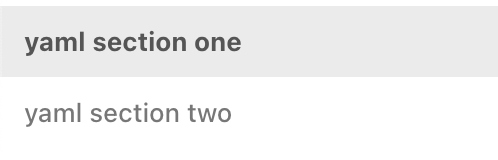

### 설치형 CLI에서 환경변수를 리소스와 요청에 전달하려면 어떻게 하나요?

설치형 환경에서는 클라우드 관리 화면에 등록한 환경변수가 설치형 서버에 자동으로 전달되지 않습니다. 실행 환경에서 CLI 프로세스에 환경변수를 전달하고, 리소스 설정과 요청 파라미터에서 각각 참조하는 방식이 공유되었습니다.

리소스 연결 설정 예시:

```yaml
resources:
  - name: mysql.dev
    type: mysql
    host: $DB_HOST
    port: $DB_PORT
    username: $DB_USERNAME
    password: $DB_PASSWORD
```

요청 파라미터에서 환경변수를 참조하는 예시:

```yaml
params:
  - key: APP_API_KEY
    valueFromEnv: APP_API_KEY
```

원문 안내에서는 리소스 설정에 `$DB_HOST`처럼 환경변수를 사용하고, 요청이나 쿼리에서 접근할 환경변수는 `APP_` 접두어를 사용하도록 설명합니다. 실제 전달 범위와 접두어 규칙은 설치형 배포 버전에서 확인해 주세요. 비밀번호와 API 키는 로그나 화면에 노출하지 않도록 주의해야 합니다.

### Supabase 데이터에 queryFn으로 접근하려면 어떻게 하나요?

Supabase 리소스에서는 `queryFn`을 사용해 JavaScript로 조회할 수 있습니다. 원문 예제에서는 테이블의 모든 행을 조회한 뒤 검색과 페이지네이션 옵션을 적용했습니다.

```yaml
- type: query
  resource: supabase.dev
  sqlType: select
  queryFn: |
    const result = await supabase
      .from('templates')
      .select('*')
    return result
  searchOptions:
    enabled: true
  paginationOptions:
    enabled: true
    perPage: 10
```

`resource`에는 실제로 연결한 Supabase 리소스 이름을 지정하고, 테이블명과 선택할 컬럼은 데이터 구조에 맞게 변경해 주세요.

### DynamoDB를 queryFn으로 조회·수정·추가하려면 어떻게 하나요?

DynamoDB 리소스에서는 `queryFn`에서 SDK 클라이언트를 호출해 조회, 수정, 추가 작업을 구성할 수 있습니다. 아래는 조회와 수정 흐름의 간단한 예시입니다.

```yaml
- type: query
  resource: dynamodb
  sqlType: select
  queryFn: |
    if (property_id) {
      return await client.send(new QueryCommand({
        TableName: 'test',
        KeyConditionExpression: 'test = :property_id',
        ExpressionAttributeValues: {
          ':property_id': property_id
        }
      }))
    }

    return await client.send(new ScanCommand({
      TableName: 'test',
      Limit: 10
    }))
  params:
    - key: property_id
```

수정이나 추가 작업은 `ExecuteStatementCommand` 등 해당 작업에 맞는 명령을 `queryFn`에서 호출하는 방식으로 구성할 수 있습니다. 테이블 키, 인덱스, 권한 및 SDK 명령은 실제 DynamoDB 스키마에 맞춰야 합니다.

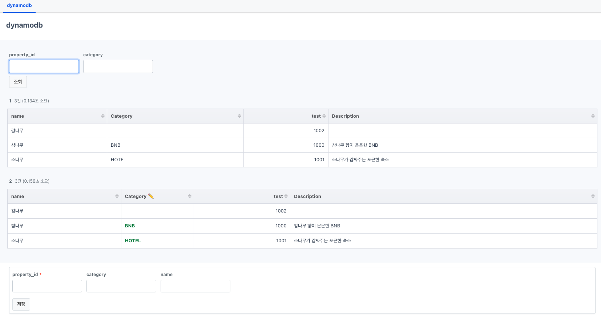

### Redis 명령을 query 블록에서 실행하려면 어떻게 하나요?

Redis 리소스를 지정한 `query` 블록에서 `commands`에 Redis 명령을 작성할 수 있습니다.

```yaml
- type: query
  resource: redis-cloud
  sqlType: select
  commands:
    - INCR orders:view
    - GET orders
```

여러 명령을 트랜잭션으로 실행하려면 `MULTI`와 `EXEC`를 사용할 수 있습니다.

```yaml
- type: query
  resource: redis-cloud
  sqlType: select
  commands:
    - MULTI
    - GET orders:count
    - GET orders:view
    - EXEC
```

Redis 명령의 결과를 `responseFn`에서 가공할 수 있습니다. 명령의 실행 결과와 반환 형식은 사용 중인 Redis 리소스 및 명령에 따라 확인해 주세요.

### 차트의 가로축과 세로축을 바꿔 가로 막대 차트를 만들려면 어떻게 하나요?

Chart.js 기반 차트에서는 `chartOptions.options.indexAxis`를 `y`로 설정해 가로 막대 형태로 표시할 수 있습니다.

```yaml
chartOptions:
  height: 500px
  type: bar
  x: name
  y:
    - volume
  options:
    indexAxis: y
    scales:
      x:
        grid:
          display: false
      y:
        grid:
          display: false
```

축의 그리드를 숨기거나 차트 높이를 조정해 항목이 많은 순위표를 보기 쉽게 만들 수 있습니다.

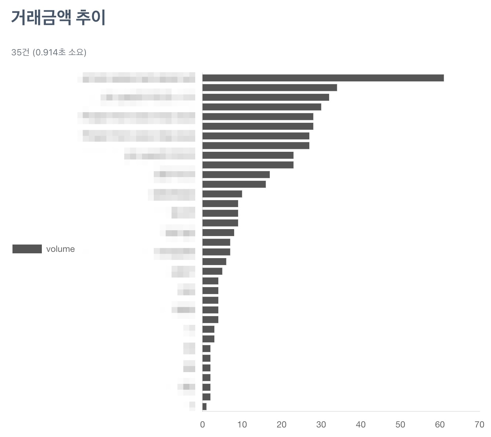

### displayFn으로 조회 데이터를 가공해 사용자 지정 차트를 만들려면 어떻게 하나요?

`displayFn`에서는 조회 결과인 `rows`를 JavaScript로 가공해 Chart.js 등의 차트 라이브러리에 전달할 수 있습니다. 원문에서는 카테고리별 매출 도넛 차트, 고객 세그먼트별 레이더 차트, 캠페인 예산과 매출을 비교하는 버블 차트 등의 예제를 공유했습니다.

간단한 도넛 차트 예시:

```yaml
display: chartjs
id: salesChart
displayFn: |
  const totals = {}
  rows.forEach(row => {
    totals[row.category] = (totals[row.category] || 0) + row.revenue
  })

  const data = {
    labels: Object.keys(totals),
    datasets: [{
      data: Object.values(totals)
    }]
  }

  new Chart(ctx, {
    type: 'doughnut',
    data,
    options: { responsive: true }
  })
```

차트를 그리는 블록의 `id`와 `displayFn`에서 사용하는 요소 ID가 일치해야 합니다. 여러 쿼리를 함께 실행하는 `sqlMany`를 사용하는 경우 조회 결과가 `rows[0]`, `rows[1]` 등에 담기는 방식도 활용할 수 있습니다.

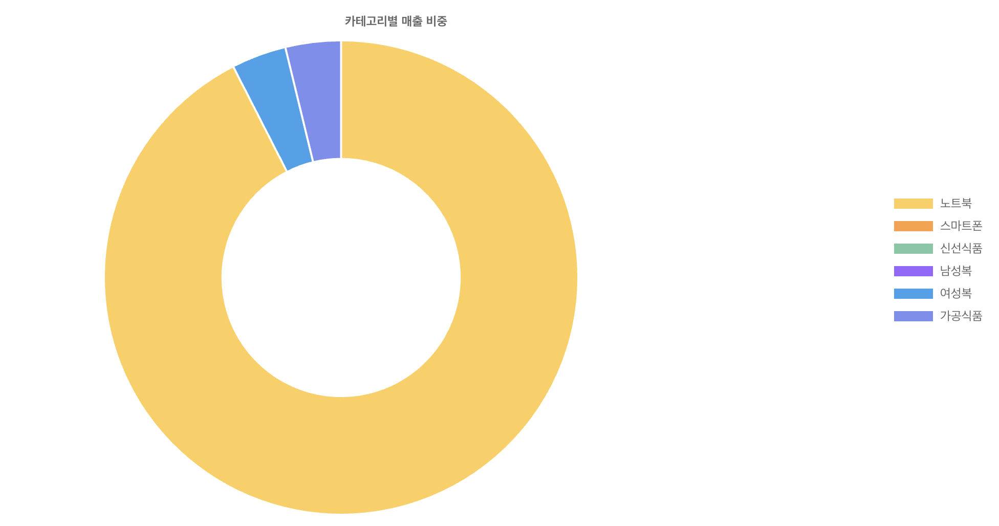

### Chart.js 누적 막대의 각 항목 합계를 막대 위에 표시하려면 어떻게 하나요?

누적 막대 차트의 합계를 별도로 표시하려면 `displayFn`에서 Chart.js 플러그인의 `afterDatasetsDraw`를 활용할 수 있습니다. 각 데이터셋의 값을 더한 뒤 차트 좌표에 합계를 그리는 방식입니다.

```javascript
plugins: [{
  id: 'stackedSum',
  afterDatasetsDraw(chart) {
    const ctx = chart.ctx
    chart.data.labels.forEach((label, index) => {
      const sum = chart.data.datasets.reduce((total, dataset) => {
        return total + (Number(dataset.data[index]) || 0)
      }, 0)
      const x = chart.scales.x.getPixelForValue(index)
      const y = chart.scales.y.getPixelForValue(sum)
      ctx.save()
      ctx.textAlign = 'center'
      ctx.textBaseline = 'bottom'
      ctx.fillText(sum.toFixed(2), x, y - 5)
      ctx.restore()
    })
  }
}]
```

위 코드는 차트의 플러그인 설정에 추가하는 예시입니다. 차트 축 ID, 누적 방향, 데이터셋 구조에 따라 좌표 계산을 조정해야 합니다.

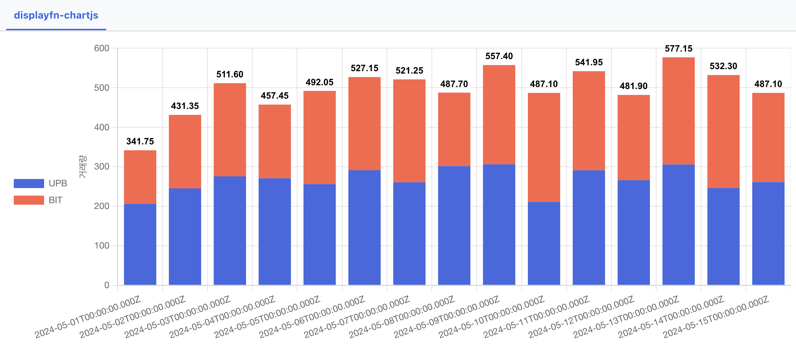

### ECharts로 조회 데이터를 시각화하려면 어떻게 하나요?

`display: echarts`와 `displayFn`을 사용해 조회 결과를 ECharts 인스턴스에 전달할 수 있습니다.

```yaml
display: echarts
id: chart1
displayFn: |
  const chart = echarts.init(document.getElementById(id))
  chart.setOption({
    title: { text: 'Basic Bar Chart' },
    tooltip: {},
    legend: { data: ['Sales'] },
    xAxis: {
      data: ['Shirts', 'Cardigans', 'Pants']
    },
    yAxis: {},
    series: [{
      name: 'Sales',
      type: 'bar',
      data: [5, 20, 36]
    }]
  })
```

위 예제는 고정된 샘플 데이터를 사용합니다. 실제 조회 결과를 사용하려면 `rows`를 순회해 `xAxis.data`와 `series.data`를 구성하면 됩니다. 차트를 그리는 블록의 `id`를 동일하게 사용해야 합니다.

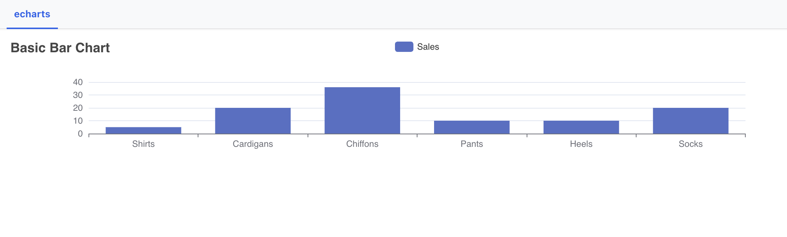

### 지도에 마커를 표시하고 클릭 시 상세 모달을 열려면 어떻게 하나요?

`display: map`과 `displayFn`을 사용하면 조회한 위도·경도 데이터로 마커를 표시하고, 마커를 클릭했을 때 선택한 행을 모달에 전달할 수 있습니다.

```yaml
display: map
displayFn: |
  for (const row of rows) {
    const marker = new naver.maps.Marker({
      position: new naver.maps.LatLng(row.lat, row.long),
      title: row.name,
      map: map
    })

    naver.maps.Event.addListener(marker, 'click', () => {
      openModal('view', row)
    })
  }

  if (rows.length) {
    map.setCenter(new naver.maps.LatLng(rows[0].lat, rows[0].long))
  }
mapOptions:
  zoom: 15
  zoomControl: true
modals:
  - path: view
    blocks:
      - type: query
        resource: mysql.qa
        sqlType: select
        sql: SELECT * FROM test_map WHERE id = :id
        params:
          - key: id
            valueFromRow: true
```

`displayFn`에서는 네이버 지도 API를 이용해 마커뿐 아니라 폴리곤과 폴리라인도 표시할 수 있습니다. 실제 지도 표시를 위해서는 좌표 데이터와 지도 API 사용 설정이 필요합니다.


### display: form의 컬럼에 openModal 또는 openAction을 연결하려면 어떻게 하나요?

`display: form`에서도 컬럼의 `openModal`과 `openAction`을 사용할 수 있도록 수정된 사례가 공유되었습니다.

```yaml
- type: query
  resource: mysql.qa
  sqlType: select
  sql: SELECT * FROM wine_stock LIMIT 10
  display: form
  columns:
    name:
      openModal: view
    vintage:
      openAction: markAsResolved
  modals:
    - path: view
      blocks:
        - type: markdown
          content: |
            ## Product: {{name}}
            Vintage: {{vintage}}
  actions:
    - name: markAsResolved
      type: http
      hidden: true
      axios:
        url: https://example.com/status/200
```

모달과 액션 이름은 `openModal`, `openAction`에 지정한 값과 일치해야 합니다. 원문에서는 해당 기능이 패치된 뒤 위와 같은 사용 예제가 안내되었습니다.


### 모달을 특정 사용자나 권한 그룹에만 표시하려면 어떻게 하나요?

모달에 `roles`를 지정해 계정 또는 권한 그룹에 따라 모달 접근을 제한할 수 있습니다.

```yaml
modals:
  - path: view
    roles:
      message: 해당 내역을 조회할 권한이 없습니다.
      view:
        - email::user@example.com
    blocks:
      - type: query
        resource: mysql.qa
        sqlType: select
        sql: SELECT * FROM wine_stock WHERE id = :id
```

모달 접근을 제한하는 것과 서버 측 데이터 접근을 제한하는 것은 별개입니다. 서버까지 보호해야 하는 데이터라면 모달 표시 여부만 제어하지 말고, 해당 데이터를 조회하는 블록에도 권한을 설정해야 합니다.


### 여러 파라미터에서 날짜 기본값과 빠른 선택 기간을 설정하려면 어떻게 하나요?

`defaultValueFn`에서 Moment.js 또는 날짜 라이브러리를 이용해 기본 날짜를 계산할 수 있습니다. 날짜 범위 파라미터는 시작일과 종료일을 배열로 반환합니다.

```yaml
params:
  - key: dateFromTo
    label: 조회기간
    format: date
    range: true
    defaultValueFn: |
      return [
        moment().add(1, 'week').startOf('week').add(1, 'day').format('YYYY-MM-DD'),
        moment().add(1, 'week').endOf('week').add(1, 'day').format('YYYY-MM-DD')
      ]
    shortcuts:
      - label: 지난주
        relative: true
        from:
          offset: -7
          period: day
        to:
          offset: -7
          period: day
      - label: 다음주
        relative: true
        from:
          offset: 7
          period: day
        to:
          offset: 7
          period: day
```

날짜 기본값을 계산하는 간단한 표현식은 다음과 같습니다.

```javascript
moment().format('YYYY-MM-DD')
moment().add(1, 'day').format('YYYY-MM-DD')
moment().startOf('month').format('YYYY-MM-DD')
moment().endOf('month').format('YYYY-MM-DD')
```

모달 안에서 `defaultValueFn`을 사용할 때는 `row`를 통해 현재 행의 값을 참조할 수도 있습니다. 날짜 라이브러리와 함수 지원 범위는 실행 환경에 맞춰 확인해 주세요.


### HTTP API 검색 파라미터 값이 비어 있으면 query string에서 제외하려면 어떻게 하나요?

HTTP 요청의 `params`에서 빈 값을 `null`로 지정하면 값이 없는 파라미터를 query string에서 제외하는 방식이 공유되었습니다.

```yaml
- type: http
  axios:
    method: GET
    url: https://example.com/api
    params:
      searchName: "{{ searchName || null }}"
  params:
    - key: searchName
```

실제 빈 문자열, `null`, `undefined`가 요청 라이브러리에서 처리되는 방식은 다를 수 있으므로 브라우저 개발자 도구의 Network 탭에서 최종 요청 URL을 확인해 주세요.


### 조회 블록의 검색을 Enter 키를 눌렀을 때 실행하려면 어떻게 하나요?

검색어를 입력할 때마다 검색하지 않고 Enter 키를 눌렀을 때 검색을 실행하려면 `searchOptions.trigger`를 `enter`로 설정할 수 있습니다.

```yaml
searchOptions:
  enabled: true
  trigger: enter
```

검색 대상 데이터가 수천 건 이상이면 클라이언트 검색 과정에서 입력이 느려질 수 있습니다. 검색에 필요한 컬럼만 조회하거나 서버 측 검색으로 처리하는 방식을 검토해 주세요.

### responseRowFn에서 API 응답을 행 단위로 가공하려면 무엇을 확인해야 하나요?

`responseRowFn`은 응답의 각 행을 가공할 때 사용할 수 있습니다. API 응답이 객체인지 배열인지에 따라 화면에 표시되는 구조가 달라질 수 있으므로, 먼저 실제 응답 구조를 확인해야 합니다.

원문 사례에서는 배열 형태의 응답을 `showResult: table`로 표시할 때 첫 번째 배열 요소를 기준으로 표시하도록 수정된 내용이 공유되었습니다. 필요한 필드만 표시하려면 `columns`에서 불필요한 필드를 숨기고 표시할 필드의 라벨을 지정할 수 있습니다.

```yaml
showResult: table
columns:
  success:
    hidden: true
  message:
    label: 메시지
  execution_id:
    label: 실행 ID
  execution_version:
    label: 실행 버전
```

API가 반환하는 배열과 객체의 중첩 구조에 따라 `rowsPath`, `responseFn`, `responseRowFn` 중 적절한 처리 방식을 선택해 주세요.

### 엑셀 업로드 후 INSERT를 실행하기 전에 중복 데이터를 검사하려면 어떻게 하나요?

엑셀 시트의 데이터를 먼저 읽고, 중복 검사 쿼리를 실행한 다음 중복이 없을 때만 INSERT를 진행하도록 구성할 수 있습니다.

```yaml
- type: query
  id: findNames
  resource: mysql.qa
  sqlType: select
  autoload: false
  sql: |
    SELECT name FROM properties
    WHERE name IN ('', :names)
  params:
    - key: names
      hidden: true

- type: query
  resource: mysql.qa
  sqlType: select
  sql: SELECT 1
  actions:
    - label: 엑셀 업로드
      type: query
      resource: mysql.qa
      sqlType: insert
      forEach: true
      sql: |
        INSERT INTO properties (name, address)
        VALUES (:name, :address)
      params:
        - key: sheet
          format: sheet
        - key: name
          valueFromSheet: 이름
        - key: address
          valueFromSheet: 주소
      requestFn: |
        const sheet = params.find(item => item.key === 'sheet')
        if (!sheet || sheet.values.length === 0) {
          toast('업로드할 데이터가 없습니다.')
          return false
        }

        const names = sheet.values.map(item => item['이름'])
        const nameParam = findNames.$params.find(item => item.key === 'names')
        nameParam.values = names

        const result = await findNames.trigger()
        if (result.rows.length) {
          const duplicates = result.rows.map(item => item.name)
          toast(`중복된 이름이 있습니다: ${duplicates.join(', ')}`)
          return false
        }
        return true
```

예제의 테이블명과 컬럼명은 실제 데이터에 맞게 변경해야 합니다. 동시 업로드나 중복 데이터가 이미 존재하는 상황까지 안전하게 처리하려면 데이터베이스의 UNIQUE 제약 조건 등 서버 측 검증도 함께 사용하는 것이 좋습니다.

### Tiptap 또는 Toast 에디터에서 이미지 업로드 동작을 커스텀하려면 어떻게 하나요?

에디터 종류에 따라 `editorOptions`에서 이미지 처리 함수를 지정할 수 있습니다.

Tiptap 예시:

```yaml
params:
  - key: memo
    format: tiptap
    editorOptions:
      setImage: |
        console.log(file)
        return uploadedImageUrl
```

Toast 에디터 예시:

```yaml
params:
  - key: memo
    format: editor
    editorOptions:
      hooks: |
        return {
          addImageBlobHook: (blob, callback) => {
            // blob을 스토리지에 업로드한 뒤 반환된 URL을 전달합니다.
            callback(uploadedImageUrl, 'image alt text')
          }
        }
```

`uploadedImageUrl`은 실제 업로드 API 또는 스토리지에서 반환된 이미지 URL로 바꿔야 합니다. 에디터에 이미지 URL을 전달하는 것과 이미지 파일을 실제 스토리지에 업로드하는 것은 별도 작업입니다.


### display: form 이외의 화면에서 컬럼 링크로 모달이나 액션을 실행할 수 있나요?

`display: form`에서도 `columns`의 `openModal`, `openAction`을 사용할 수 있도록 수정된 사례가 공유되었습니다. 테이블에서만 동작하던 컬럼 링크를 폼 화면에서도 활용할 수 있습니다.

```yaml
- type: query
  resource: mysql.qa
  sqlType: select
  sql: SELECT * FROM wine_stock LIMIT 10
  display: form
  columns:
    name:
      openModal: view
    vintage:
      openAction: markAsResolved
```

해당 기능은 원문에서 패치 완료로 안내되었습니다. 실제 배포 버전에서 동작하지 않는다면 최신 버전 여부와 컬럼 설정 위치를 확인해 주세요.

## 문제 해결

### 테이블 검색이 느리거나 입력할 때 화면이 버벅입니다. 어떻게 개선할 수 있나요?


조회 결과가 매우 많은 경우 클라이언트에서 검색·렌더링하는 과정이 느려질 수 있습니다. 커뮤니티 사례에서는 수천~수만 건의 데이터를 한 번에 조회할 때 입력 지연이 발생했고, 검색 대상 데이터를 줄이는 방식으로 개선했습니다.

다음 방법을 검토해 주세요.

1. 필요한 컬럼과 행만 조회하도록 SQL을 줄입니다.
2. 검색 대상 데이터의 범위를 줄입니다.
3. 데이터가 많은 경우 서버 사이드 검색 및 페이지네이션을 검토합니다.

검색 동작을 엔터 입력 시 실행하도록 설정하는 예제로 `searchOptions.trigger: enter`도 소개되어 있습니다.

```yaml
searchOptions:
  enabled: true
  trigger: enter
```

### API 요청이 timeout 또는 Network Error로 실패합니다. 무엇을 확인해야 하나요?

요청 오류가 발생하면 우선 다음 항목을 확인해 주세요.

- API 서버가 정상적으로 응답하는지 확인합니다.
- 요청 URL, HTTP method, query parameter, body 및 header가 올바른지 확인합니다.
- API 서버의 응답 시간이 요청 제한 시간을 초과하는지 확인합니다.
- 브라우저 개발자 도구의 Network 탭에서 실제 요청과 응답 상태를 확인합니다.
- 서버 측 방화벽, CORS, 인증 및 접근 허용 IP 설정을 확인합니다.

`timeout of 5000ms exceeded` 오류는 특정 API 요청이 제한 시간 안에 응답하지 못한 상황을 의미합니다. 이 메시지만으로 원인을 단정할 수는 없으므로 API 서버 로그와 실제 네트워크 응답을 함께 확인해야 합니다.

### 특정 화면에 접근했는데 빈 화면만 표시됩니다. 무엇을 확인해야 하나요?

페이지 권한이 없거나 로그인이 만료된 경우일 수 있습니다. 다음 사항을 확인해 주세요.

- 현재 로그인한 계정에 해당 페이지의 접근 권한이 있는지 확인합니다.
- 메뉴 및 페이지의 `roles` 설정을 확인합니다.
- 공유받은 URL이 올바른지 확인하고, 로그인 후 다시 접근합니다.
- 문제가 계속되면 브라우저 개발자 도구의 Console 및 Network 오류를 확인합니다.

메뉴와 페이지의 `roles` 설정이 현재 계정에 맞게 적용되어 있는지 확인해 주세요.

### 화면에 표시되는 오류를 문의하려면 어떤 정보를 전달해야 하나요?

문제를 재현하고 원인을 파악할 수 있도록 다음 정보를 함께 전달해 주세요.

- 문제가 발생한 페이지 또는 기능
- 문제가 발생하기까지의 단계
- 예상한 동작과 실제 동작
- 오류 메시지 전문
- 브라우저 및 운영체제 정보
- 관련 YAML 설정 중 문제 재현에 필요한 부분
- 개발자 도구 Console 및 Network 오류(가능한 경우)

API 키, 비밀번호, 액세스 토큰, 개인정보 및 실제 고객 데이터는 반드시 삭제하거나 가린 뒤 공유해 주세요.

문의 전 문제 발생 단계, 오류 메시지, 관련 설정과 로그를 함께 정리하면 원인을 파악하는 데 도움이 됩니다.

### 편집기에서 콘솔 로그를 확인하려면 어떻게 하나요?

쿼리나 HTTP API 요청을 개발하고 테스트할 때는 편집기 오른쪽 위의 **콘솔 로그**에서 요청과 응답 원본을 확인할 수 있습니다.

콘솔 로그에는 다음 항목이 표시됩니다.

- `query Request`, `query Response`
- `query Request (sqlTransaction)`, `query Response (sqlTransaction)`, `query Commit (sqlTransaction)`
- `http Request`, `http Response`

`sqlWith`를 통해 사용하는 SQLite in-memory DB 요청도 `query Request`로 표시됩니다.


로그 목록에서는 다음 기능을 사용할 수 있습니다.

- `Cancel`: 로그 지우기
- `Me`: 내 로그만 보기
- `Request`: 요청 로그 표시 여부
- `Response`: 응답 로그 표시 여부


콘솔 로그는 실시간으로 편집 중인 사용자에게만 전송되며 저장되지 않습니다. 새로고침하면 로그가 사라지고, 어드민 최종 사용자에게는 노출되지 않습니다. 로그를 확인하려면 어드민 관리자 또는 편집 권한이 필요합니다.

### SQL에서 URL의 물음표를 포함할 때 어떻게 처리하나요?

SQL 결과에서 URL 문자열을 직접 조합하는 과정에서 `?`가 포함된 URL이 파라미터 치환과 함께 사용될 때 parsing 오류가 발생한 사례가 있습니다.

해당 사례에서는 SQL의 `CONCAT()` 등으로 링크 문자열을 직접 만들기보다, 컬럼의 `openUrl` 옵션에서 URL을 구성하는 방식으로 변경해 사용했습니다.

```yaml
columns:
  shop:
    openUrl: "https://{{shopOpenUrl}}?id={{id}}"
```

`shopOpenUrl`과 `id`는 조회 결과에 포함된 필드명으로 바꿔 주세요. 이 내용은 특정 SQL 구성에서 공유된 우회 사례이므로, 모든 물음표 관련 SQL 오류에 적용되는 일반적인 해결책으로 단정할 수는 없습니다.

### Actions에서 searchOptions의 resource 오류가 발생하면 어떻게 하나요?

`actions` 아래의 `params.searchOptions`에서 `resource`를 찾지 못한다는 오류가 보고된 사례가 있습니다. 원문에서는 테스트 결과 문제가 `actions` 하위의 `params`에서 발생하고, 페이지 또는 블록 요소의 `params`에서는 발생하지 않는 것으로 확인했습니다.

답변에서는 기존 `modal: true` 방식이 레거시 기능이며 제약이 있으므로, `actions` 안에서 `openModal`과 `modals`를 사용해 모달 내부의 블록을 구성하는 방식을 권장합니다.

문제가 발생한 설정이 `actions > params > searchOptions` 내부인지, 페이지나 블록의 `params` 내부인지 먼저 구분해 확인해 주세요. 두 위치에서 동작이 다를 수 있습니다.

### HTTP 데이터 테이블에서 정렬하려면 어떻게 하나요?

HTTP 요청으로 데이터를 표시하는 테이블에서 `pagination`을 원격 모드(`mode: remote`)로 사용하는 경우, 페이지 이동과 정렬을 서버에서 처리해야 합니다. 이 모드에서는 셀렉트어드민의 기본 클라이언트 정렬에 의존할 수 없습니다.

서버에서 페이지네이션을 처리하려면 다음 파라미터를 전달하는 구성을 검토해 주세요.

- `page_offset`: 조회 시작 위치
- `page_limit`: 한 번에 가져올 행 수
- `page_number`: 현재 페이지 번호

정렬이 필요하다면 정렬 기준을 전달하는 별도의 `sort` 파라미터도 추가하고, API 서버에서 해당 값을 반영해 정렬된 결과를 반환해야 합니다.

서버에서 페이지네이션과 정렬을 처리하도록 구성한 뒤, 페이지 이동 및 정렬 기준 변경이 API 요청에 반영되는지 확인해 주세요.